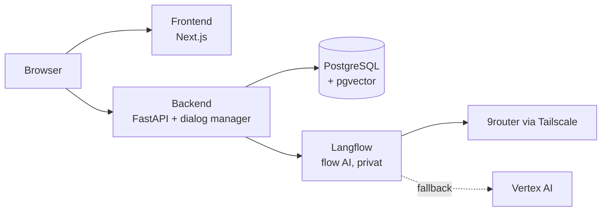

# IT Career Compass

> Platform pemetaan karir berbasis Agentic AI untuk mahasiswa Teknologi Informasi.
> Dikembangkan oleh tim **LearnFl0w** sebagai proyek UAS Cloud Computing. Nama repositori: `learnfl0w`.

| | |
|---|---|
| **Status** | Dalam pengembangan (V1) |
| **Tenggat demo** | 8 Desember 2026 |
| **Deployment cloud** | Di akhir (28 Nov sampai 3 Des 2026); pengembangan dan staging di lokal |
| **Dokumen utama** | [PRD](docs/product/PRD.md) · [Arsitektur](docs/architecture/overview.md) · [Spec](docs/specs/README.md) |

## Ringkasan

Mahasiswa TI sering bingung menentukan arah karir, terutama menjelang magang. IT Career Compass memandu mahasiswa lewat **konsultasi AI interaktif**, lalu menghasilkan **roadmap karir visual** (node-edge) yang menghubungkan:

- tahapan belajar,
- mata kuliah di kampus (lengkap dengan status dan nilai dari transkrip),
- materi belajar, dan
- sertifikasi (gratis/berbayar).

Seluruh rekomendasi bersumber dari **katalog terkurasi** (RAG), bukan karangan model.

## Fitur V1

- Registrasi dan login (email + password, JWT)
- Profil dan transkrip (input manual atau CSV)
- Konsultasi AI hybrid (slot-filling, streaming)
- Generator roadmap dengan guardrails dan roadmap templat sebagai cadangan
- Pencari sertifikasi dan materi belajar
- Panel Admin: kelola katalog, dashboard tren dan operasional

Cakupan lengkap dan yang di luar scope ada di [PRD](docs/product/PRD.md).

## Arsitektur Singkat



Detail: [docs/architecture/overview.md](docs/architecture/overview.md).

## Tech Stack

| Lapisan | Teknologi |
|---|---|
| Frontend | Next.js (App Router), TypeScript, React Flow |
| Backend | Python 3.12, FastAPI, SQLAlchemy 2 (async), Alembic |
| AI | Langflow (flow visual) dipanggil FastAPI; keluaran terstruktur divalidasi Pydantic |
| Data | PostgreSQL 16 + pgvector |
| Cloud | GCP: Cloud Run, Cloud SQL, Vertex AI, Secret Manager, Artifact Registry |
| CI/CD | GitHub Actions + Workload Identity Federation |

## Struktur Repositori

```text
.
├── AGENTS.md        # aturan untuk AI coding agent (OpenCode)
├── opencode.json    # konfigurasi OpenCode
├── backend/         # API, dialog manager, klien Langflow (FastAPI)
├── langflow/        # flow AI (Langflow), image kustom, validasi flow
├── frontend/        # Web app (Next.js)
├── data/seed/       # data awal katalog
├── docs/            # semua dokumentasi (lihat docs/README.md)
├── infra/           # konfigurasi deploy dan infrastruktur
├── scripts/         # skrip bantu
└── .github/         # CI/CD, template issue dan PR
```

## Memulai

**Prasyarat:** Docker 24+ dengan Compose v2, Python 3.12, Node.js 22, GNU Make.

```bash
cp .env.example .env        # isi nilai rahasia (lihat komentar di file)
make up                     # jalankan db, backend, frontend
make migrate                # terapkan migrasi database
make seed                   # muat data katalog awal
```

- Frontend: <http://localhost:3000>
- API: <http://localhost:8080> (dokumentasi interaktif di `/docs`)
- Langflow (menyusun flow): <http://localhost:7860>

Pertama kali menjalankan frontend, jalankan `npm install` di `frontend/` dan commit `package-lock.json`.

## Perintah Umum

| Perintah | Fungsi |
|---|---|
| `make up` / `make down` | Menyalakan / mematikan stack lokal |
| `make logs` | Melihat log layanan |
| `make check` | Lint + typecheck + test (wajib hijau sebelum PR) |
| `make test` | Menjalankan seluruh test |
| `make lint` / `make format` | Cek / rapikan kode |
| `make migrate` | Menerapkan migrasi Alembic |
| `make seed` | Memuat data dari `data/seed/` |
| `make staging-up` | Staging lokal yang meniru cloud (jalankan dari cabang `dev`) |
| `make smoke` | Pemeriksaan kesehatan semua layanan |
| `make flows-check` | Validasi flow Langflow yang diekspor |

## Alur Pengembangan

Proyek ini memakai pendekatan **spec-first**, dan dikerjakan dengan bantuan [OpenCode](https://opencode.ai):

1. Pilih spec di [docs/specs](docs/specs/README.md) (satu spec = satu unit kerja).
2. Gunakan agent **Plan** untuk merancang pendekatan, lalu **Build** untuk implementasi.
3. Jalankan `make check`, buka Pull Request **ke `dev`** dari cabang `feat/`, `fix/`, atau `chore/` sesuai [CONTRIBUTING.md](CONTRIBUTING.md).

Aturan untuk agent ada di [AGENTS.md](AGENTS.md); skill dan tips hemat token ada di [docs/engineering/opencode-setup.md](docs/engineering/opencode-setup.md).

## Cabang dan Lingkungan

| Cabang | Fungsi | Berjalan di |
|---|---|---|
| `feat/`, `fix/`, `chore/` | Pekerjaan harian | Lokal (`make up`) |
| `dev` | Integrasi | Staging lokal (`make staging-up`) |
| `main` | Rilis dan demo | Cloud GCP, **dideploy di akhir** |

Detail: [git-workflow.md](docs/engineering/git-workflow.md).

## Dokumentasi

Indeks lengkap: [docs/README.md](docs/README.md).

## Tim

| Peran | Nama |
|---|---|
| Backend, AI & Deployment | Anaya |
| Frontend | Bastian |

## Lisensi

[MIT](LICENSE)
