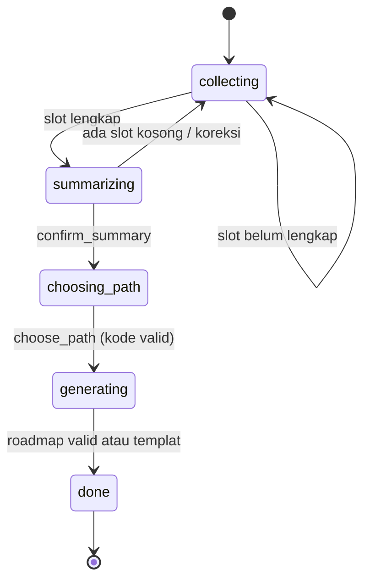

# Desain AI

> **Status:** Draft | **Pemilik:** Anaya | **Diperbarui:** 2026-11-03
> Rujukan: [PRD bagian 8](../product/PRD.md), [ADR-0010](../adr/0010-langflow-dan-fastapi-untuk-lapisan-ai.md), [ADR-0008](../adr/0008-roadmap-structured-output-dan-templat-fallback.md). Kontrak flow: [langflow-flows.md](../api/langflow-flows.md).

## 1. Prinsip

1. **Grounded, himpunan tertutup:** FastAPI menyiapkan daftar kandidat dari katalog; LLM hanya memilih, mengurutkan, dan menjelaskan.
2. **Terstruktur:** roadmap adalah JSON yang divalidasi terhadap [`roadmap.schema.json`](../api/roadmap.schema.json).
3. **Terkendali:** tahap konsultasi diatur **dialog manager deterministik** di FastAPI, bukan oleh LLM.
4. **Dapat diganti:** setiap flow punya varian `router` dan `vertex`; pemilihan lewat konfigurasi dan circuit breaker.
5. **Terukur:** evaluasi persona dijalankan pada setiap perubahan flow.

## 2. Pembagian Tanggung Jawab

| FastAPI (kode, deterministik) | Langflow (flow, LLM) |
|---|---|
| Auth, RBAC, batas pemakaian | `slot-extractor`: ekstraksi slot dan niat |
| Dialog manager (tahap dan transisi) | `consultant-reply`: balasan percakapan (stream) |
| Input dan output guardrails | `path-advisor`: saran 1 sampai 3 jalur |
| Retrieval katalog (pgvector), himpunan kandidat tertutup | `roadmap-builder`: penyusunan roadmap dari kandidat |
| Validasi roadmap, roadmap templat, versi | Pemanggilan model (9router atau Vertex AI) |
| Circuit breaker, timeout, pemilihan varian | Pemanggilan tool katalog (endpoint internal FastAPI) |
| Persistensi pesan, slot, tahap, `ai_runs` | Prompt dan parameter model (di dalam flow) |

Langflow **stateless** dan **privat**. UI Langflow hanya dipakai di lokal untuk menyusun flow.

## 3. Flow V1

Nama di Langflow: `<flow>__router` dan `<flow>__vertex`; kedua varian punya antarmuka identik.

| Flow | Mode | Keluaran | Temperature | Tool |
|---|---|---|---|---|
| `slot-extractor` | Non-stream | JSON `slots_update`, `intent`, `chosen_path` | 0.0 sampai 0.1 | - |
| `consultant-reply` | **Stream** | Teks Indonesia tanpa URL | 0.4 | `certification_finder`, `material_finder` |
| `path-advisor` | Non-stream | JSON 1 sampai 3 `{code, reason}` | 0.2 | - |
| `roadmap-builder` | Non-stream | Roadmap JSON | 0.2 | - |

Kontrak input dan output rinci: [`docs/api/langflow-flows.md`](../api/langflow-flows.md).

## 4. Dialog Manager

Implementasi: `backend/app/ai/dialog/state.py` (logika murni, tanpa I/O; diuji unit).

**Slot wajib:** `interests`, `current_skills`, `work_style`, `hours_per_week`, `internship_target`, `budget_pref`. Slot yang sudah ada di profil atau transkrip diisi otomatis dan hanya dikonfirmasi. Nilai `0` pada slot angka dianggap kosong.

**Aksi:** `ask_slot`, `summarize`, `offer_paths`, `answer_question`, `redirect`, `generate_roadmap`, `finish`.

**Algoritma per giliran:**

1. Input guardrails dan batas pemakaian.
2. `slot-extractor` -> validasi Pydantic -> gabung slot.
3. `next_step(stage, slots, intent, chosen_path, valid_paths)` -> tahap dan aksi berikutnya.
4. `offer_paths`: FastAPI meranking jalur (kemiripan slot dengan deskripsi jalur dan pemetaan matkul), memanggil `path-advisor`, lalu memverifikasi bahwa setiap `code` ada pada daftar baku.
5. `consultant-reply` dengan instruksi aksi; token dialirkan ke pengguna (URL yang tidak berasal dari katalog dihapus).
6. Simpan pesan, slot, tahap, dan `ai_runs`.

## 5. Tools dan RAG

Tool untuk agent di `consultant-reply` adalah endpoint internal FastAPI (hanya baca, `X-Internal-Token`): lihat [`internal-tools.openapi.yaml`](../api/internal-tools.openapi.yaml). Keduanya mengembalikan **ID entitas** (`ref_id`).

| Aspek | Ketentuan |
|---|---|
| Vector store | Cloud SQL for PostgreSQL + pgvector (pencarian eksak cukup untuk data kecil) |
| Koleksi | `courses`, `career_paths`, `certifications`, `learning_materials` |
| Embedding | Vertex AI (dipanggil dari backend, `app/ai/embeddings/`); versi model per baris |
| Retrieval | Filter metadata (jalur, biaya, tingkat, `status = active`) + top-k 5 sampai 8 |
| Reindex | Otomatis saat katalog berubah, dan lewat job terjadwal |
| Sumber tautan | Hanya kolom `url` katalog |

Pencarian mata kuliah dan pembuatan roadmap **tidak** dilakukan agent: FastAPI menyiapkan **himpunan kandidat tertutup** untuk `roadmap-builder`.

## 6. Pipeline Roadmap

1. Ambil templat jalur (`career_paths.template_stages`).
2. Siapkan kandidat tertutup: matkul relevan beserta status dan nilai pengguna; sertifikasi dan materi per tahap (filter biaya dan tingkat).
3. Panggil `roadmap-builder`: LLM memilih dan mengurutkan dari kandidat, menyesuaikan beban dengan `hours_per_week` dan `internship_target`, menulis alasan singkat.
4. **Validasi:** skema, DAG, tanpa node yatim, `ref_id` hanya dari kandidat dan ada di katalog, matkul selesai tidak menjadi tugas baru, preferensi biaya.
5. Gagal: ulangi maksimal 2 kali dengan `feedback_errors`. Tetap gagal: **roadmap templat** yang dipersonalisasi secara deterministik.

## 7. Klien Langflow, Varian, dan Fallback

Satu modul: `backend/app/ai/langflow/client.py`.

| Parameter | Nilai awal |
|---|---|
| `LLM_PROVIDER` | `router` (varian utama) |
| `LLM_FALLBACK_PROVIDER` | `vertex` |
| Circuit breaker | per varian; terbuka setelah 3 kegagalan beruntun; dicoba kembali setelah 60 detik |
| Timeout | 30 detik (flow biasa), 60 detik (`roadmap-builder`); retry maksimal 2 kali |
| Streaming | Hanya `consultant-reply`; pindah varian hanya sebelum byte pertama |
| Batas | 25 giliran per sesi, 5 sesi per hari per pengguna |

Varian `router` memanggil 9router lewat Tailscale (sidecar pada layanan Langflow di cloud); varian `vertex` memakai Vertex AI dengan service account. Di lokal, Tailscale terpasang di mesin pengembang.

## 8. Guardrails

**Input (FastAPI):** sanitasi (panjang, karakter kontrol, data sensitif), anti prompt injection (pesan dan transkrip sebagai data), niat `off_topic`, rate limit.

**Output (FastAPI):**

| Kontrol | Perilaku |
|---|---|
| Himpunan tertutup | Roadmap hanya boleh memuat `ref_id` dari kandidat |
| Validasi skema | JSON Schema + Pydantic |
| Verifikasi ID dan tautan | `ref_id` ada di katalog dan `active`; URL hanya dari katalog |
| Aturan graf | DAG, tanpa node yatim, urutan fondasi ke lanjutan |
| Aturan personalisasi | Matkul selesai bukan tugas baru; preferensi biaya dihormati |
| Filter aliran teks | URL non-katalog pada balasan dihapus; referensi tampil sebagai kartu dari hasil tool |
| Larangan klaim | Tanpa janji gaji, lowongan, kelulusan |
| "Tidak tahu" | Nyatakan keterbatasan dan tawarkan alternatif katalog |

## 9. Pengelolaan Flow dan Evaluasi

- Flow disusun lokal, diekspor ke `langflow/flows/`, ditinjau lewat PR; versi Langflow dipin. Lihat [`langflow/README.md`](../../langflow/README.md).
- CI (`flows-check`): file ada untuk kedua varian, JSON valid, tidak ada rahasia, paritas struktur.

| Aspek | Metode | Target |
|---|---|---|
| Validitas skema | 20 persona sintetis | ≥ 98% |
| Grounding | `ref_id` dan URL terhadap katalog | 100% |
| Kelogisan | Aturan graf dan urutan | 100% |
| Dialog manager | Uji unit semua transisi | 100% cabang |
| Relevansi jalur | Penilaian manual (rubrik 1 sampai 5) | rata-rata ≥ 4 |
| Ketahanan | Prompt injection dan di luar topik | 100% ditangani |

Persona: `backend/tests/ai/personas/*.json`. Jalankan: `pytest backend/tests/ai -q` (fake) atau `RUN_LIVE_LLM=1 pytest backend/tests/ai -q` (Langflow dan LLM sungguhan, berbiaya).

## 10. Observabilitas

Setiap panggilan flow dicatat pada tabel `ai_runs`: flow, varian, status, durasi, token, `fallback_used`. **Tanpa** isi pesan atau data pribadi. Dashboard operasional membaca tabel ini (P50/P95, tingkat fallback, tingkat roadmap templat, biaya).
