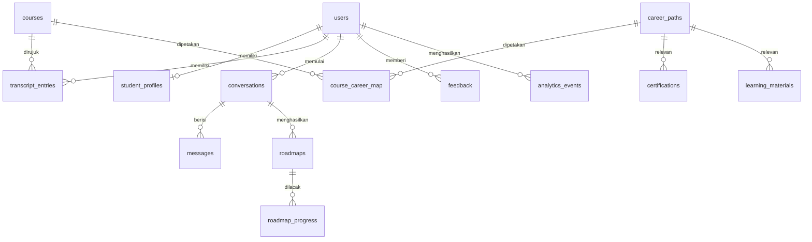

# Model Data

> **Status:** Draft | **Pemilik:** Anaya | **Diperbarui:** 2026-10-31
> Sumber rinci: [PRD bagian 9](../product/PRD.md). Implementasi: model SQLAlchemy di `backend/app/models/` dan migrasi Alembic.

## 1. Diagram Relasi

## 2. Konvensi

- Primary key: `uuid` (v4, dibuat di aplikasi). Nama tabel: `snake_case` jamak.
- Semua tabel punya `created_at` (`timestamptz`, default `now()`); tabel yang dapat diubah punya `updated_at`.
- Katalog memakai **soft delete** lewat `status` (`active`, `needs_review`, `inactive`), bukan hapus fisik.
- Kolom vektor bernama `embedding` dengan dimensi mengikuti model embedding terpilih (disimpan di `embedding_model`).
- Enum dibuat sebagai `text` dengan `CHECK` constraint agar migrasi mudah.
- `password_hash` tidak pernah dikembalikan oleh API.

## 3. Tabel Inti

### users dan student_profiles

| Tabel.Kolom | Tipe | Catatan |
|---|---|---|
| users.id | uuid PK | |
| users.email | text unik | Email untuk login (huruf kecil) |
| users.password_hash | text | Argon2id |
| users.role | text | `student` atau `admin` |
| users.is_active | boolean | |
| student_profiles.user_id | uuid PK, FK | |
| student_profiles.display_name | text | |
| student_profiles.semester | smallint | 1 sampai 8 |
| student_profiles.interests | text[] | |
| student_profiles.current_skills | text[] | |
| student_profiles.work_style | text | Hasil konsultasi |
| student_profiles.hours_per_week | smallint | |
| student_profiles.internship_target | text | |
| student_profiles.budget_pref | text | `free` atau `paid_ok` |
| student_profiles.consent_at | timestamptz | Persetujuan pemrosesan data |

### auth_refresh_tokens

| Kolom | Tipe | Catatan |
|---|---|---|
| id | uuid PK | |
| user_id | uuid FK | |
| token_hash | text | Hash SHA-256 dari refresh token |
| expires_at | timestamptz | |
| revoked_at | timestamptz null | Rotasi: token lama dicabut saat dipakai |

### courses, career_paths, course_career_map

| Tabel.Kolom | Tipe | Catatan |
|---|---|---|
| courses.id | uuid PK | |
| courses.code | text unik | Slug internal, mis. `MK-SO` (bukan kode resmi kampus) |
| courses.name | text | |
| courses.semester | smallint | 1 sampai 5 pada V1 |
| courses.description | text | Topik utama; dasar embedding |
| courses.is_mappable | boolean | `false` untuk 11 matkul non-TI |
| courses.embedding / embedding_model | vector / text | |
| career_paths.id, code | uuid, text unik | `CP-01` dan seterusnya |
| career_paths.name, description | text | |
| career_paths.template_stages | jsonb | Roadmap templat cadangan |
| career_paths.is_active | boolean | |
| course_career_map.course_id, career_path_id | uuid FK | PK gabungan |
| course_career_map.relevance | smallint | 1 sampai 3 |

### certifications dan learning_materials

| Kolom | Tipe | Catatan |
|---|---|---|
| id | uuid PK | |
| code | text unik | `CERT-001` / `MAT-001` |
| name atau title | text | |
| provider | text | |
| level | text | `beginner`, `intermediate`, `advanced` |
| cost_type | text | `free`, `paid`, `freemium` |
| url | text | **Satu-satunya sumber tautan** yang boleh ditampilkan |
| language | text | |
| format (materi) | text | `video`, `article`, `course`, `book`, `lab` |
| duration_minutes (materi) | int null | |
| career_path_ids | uuid[] | |
| topic_tags | text[] | |
| description | text | Dasar embedding |
| last_verified_at | date | |
| status | text | `active`, `needs_review`, `inactive` |
| embedding / embedding_model | vector / text | |

### transcript_entries

| Kolom | Tipe | Catatan |
|---|---|---|
| id | uuid PK | |
| user_id | uuid FK | |
| course_id | uuid FK | |
| grade_letter | text | A, AB, B, BC, C, D, E |
| semester_taken | smallint | |
| source | text | `manual` atau `csv` |

Unik: `(user_id, course_id)`.

### conversations dan messages

| Tabel.Kolom | Tipe | Catatan |
|---|---|---|
| conversations.id, user_id | uuid | |
| conversations.status | text | `active`, `completed`, `abandoned` |
| conversations.state | text | Tahap dialog manager: `collecting`, `summarizing`, `choosing_path`, `generating`, `done` |
| conversations.slots | jsonb | Slot yang terkumpul |
| conversations.started_at, ended_at | timestamptz | |
| messages.id, conversation_id | uuid | |
| messages.role | text | `user`, `assistant`, `tool`, `system` |
| messages.content | text | Tidak dicatat ke log |
| messages.tool_calls | jsonb | Nama tool dan ID entitas |
| messages.token_in, token_out | int | Pemantauan biaya |

State percakapan (tahap, slot, pesan) disimpan di sini oleh FastAPI. Flow Langflow tidak menyimpan state; metadata Langflow berada di database `langflow` yang dikelola Langflow sendiri.

### roadmaps dan roadmap_progress

| Tabel.Kolom | Tipe | Catatan |
|---|---|---|
| roadmaps.id, conversation_id, user_id | uuid | |
| roadmaps.career_path_id | uuid FK | |
| roadmaps.version | int | Naik setiap regenerasi |
| roadmaps.content | jsonb | Sesuai `docs/api/roadmap.schema.json` |
| roadmaps.source | text | `ai` atau `template` |
| roadmap_progress.roadmap_id, node_id | uuid, text | PK gabungan |
| roadmap_progress.completed_at | timestamptz | |

### feedback, link_reports, analytics_events, audit_logs

| Tabel | Kolom utama |
|---|---|
| feedback | id, user_id, target_type, target_id, rating (1 sampai 5), comment |
| link_reports | id, entity_type, entity_id, reported_by, status |
| analytics_events | id, user_pseudo_id, event_type, payload (jsonb), created_at |
| audit_logs | id, actor_id, action, entity, before (jsonb), after (jsonb) |
| ai_runs | id, conversation_id, flow_name, variant (`router` / `vertex`), status, latency_ms, tokens_in, tokens_out, fallback_used, created_at (tanpa isi pesan) |

## 4. Indeks yang Disarankan

- `users(email)` unik; `transcript_entries(user_id)`; `conversations(user_id, status)`; `messages(conversation_id, created_at)`.
- `certifications(status)`, `learning_materials(status)`, GIN pada `career_path_ids` dan `topic_tags`.
- Vektor: data katalog kecil (ratusan baris), pencarian eksak cukup. Tambahkan indeks HNSW hanya bila terbukti perlu.

## 5. Kebijakan Data

- Retensi percakapan dan roadmap: 12 bulan atau hingga dihapus pengguna (cascade).
- Dashboard memakai `user_pseudo_id` dan menyembunyikan segmen kurang dari 5 pengguna.
- Seed katalog: `data/seed/` (lihat `data/seed/README.md`).
