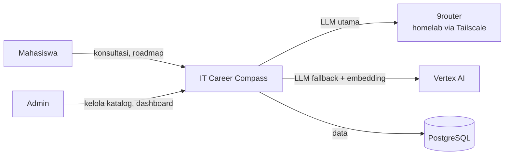
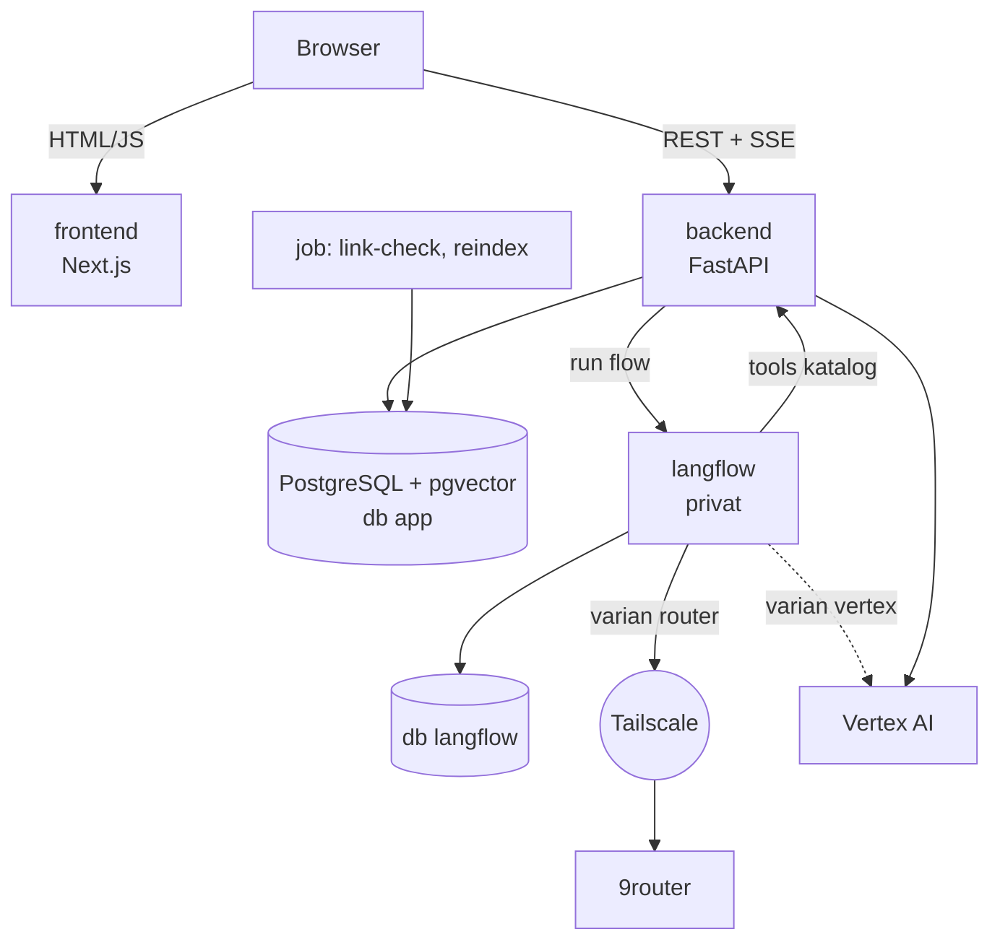
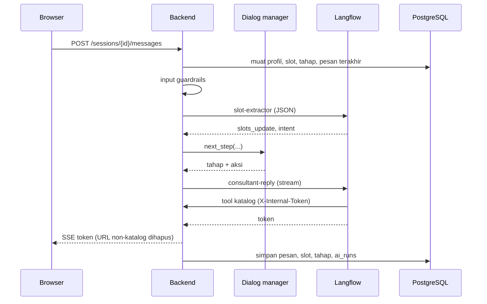
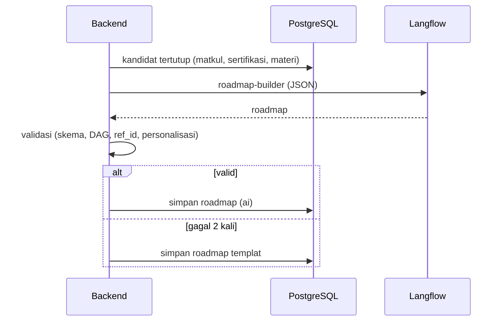

# Gambaran Arsitektur

> **Status:** Draft | **Pemilik:** Anaya | **Diperbarui:** 2026-11-03
> Rujukan rinci: [PRD bagian 5](../product/PRD.md) dan [ADR](../adr/README.md).

## 1. Tujuan dan Batasan

Sistem membantu mahasiswa TI memetakan karir lewat konsultasi AI dan roadmap node-edge. Batasan utama:

- **Pengembangan dan staging di lokal** (Docker Compose); **deployment ke GCP serverless di akhir** (28 Nov sampai 3 Des 2026);
- harus **lancar saat demo 8 Des 2026** (PRD 14.6);
- lapisan AI memakai **Langflow** yang dipanggil oleh **FastAPI**; LLM utama lewat **9router** (Tailscale) dengan fallback **Vertex AI**;
- rekomendasi **berbasis katalog terkurasi** (himpunan kandidat tertutup).

## 2. Konteks Sistem

## 3. Container

| Container | Tanggung jawab | Lokal | Cloud (di akhir) |
|---|---|---|---|
| `frontend` | UI, viewer roadmap, panel admin | Compose | Cloud Run (publik) |
| `backend` | API, auth, dialog manager, retrieval, guardrails, validator | Compose | Cloud Run (publik) |
| `langflow` | Flow LLM (4 flow x 2 varian) | Compose | Cloud Run **privat** (+ sidecar Tailscale) |
| `db` | PostgreSQL + pgvector (database `app` dan `langflow`) | Compose | Cloud SQL |
| `job` | Pemeriksa tautan, reindex | `make` / skrip | Cloud Run Job + Scheduler |

## 4. Modul Backend

| Modul | Lokasi | Tanggung jawab |
|---|---|---|
| API | `backend/app/api/v1/` | Routing, validasi input, dependensi auth |
| Services | `backend/app/services/` | Logika bisnis (profil, transkrip, roadmap, katalog, analitik) |
| Auth | `backend/app/auth/` | Hash password, JWT, refresh token, RBAC |
| AI | `backend/app/ai/` | `dialog/` (dialog manager), `langflow/` (klien + circuit breaker), `guardrails/`, `tools/`, `embeddings/`, `schemas/` |
| DB | `backend/app/db/`, `models/` | Sesi async, model SQLAlchemy |

Alur ketergantungan: `api` -> `services` -> `models`. Modul `ai` hanya dipanggil dari `services`.

## 5. Alur Runtime Utama

### 5.1 Satu Giliran Konsultasi

### 5.2 Pembuatan Roadmap

### 5.3 Fallback LLM

`LangflowClient` memanggil varian utama (`router`). Setelah 3 kegagalan beruntun, circuit breaker terbuka dan panggilan dialihkan ke varian `vertex` selama 60 detik sebelum dicoba lagi. Detail: [ai-design.md](ai-design.md) dan [ADR-0005](../adr/0005-llm-gateway-9router-dengan-fallback-vertex.md).

## 6. Prinsip Lintas-Modul

| Aspek | Keputusan |
|---|---|
| State | Stateless; sumber kebenaran percakapan di PostgreSQL (FastAPI); flow tanpa state |
| Konfigurasi | Variabel environment lewat `Settings`; rahasia di Secret Manager (cloud) |
| Keamanan | Argon2id, JWT berumur pendek, RBAC di backend, rate limit, log tanpa PII; Langflow privat |
| Observabilitas | Log terstruktur, tabel `ai_runs`, uptime check dan alert (cloud) |
| Kontrak | API publik `docs/api/openapi.yaml`; flow `docs/api/langflow-flows.md` |
| Keandalan | Kontrol REL-01 sampai REL-14 pada PRD 14.6 |

## 7. Lingkungan

| Lingkungan | Platform | Cabang | Catatan |
|---|---|---|---|
| Local | Docker Compose | `feat/`, `fix/`, `chore/` | `make up`; Langflow UI di port 7860 untuk menyusun flow |
| Staging lokal | Docker Compose + `docker-compose.staging.yml` | `dev` | `make staging-up`, `make smoke`; meniru cloud |
| Cloud (GCP) | Cloud Run, Cloud SQL, Vertex AI | `main` | **Dideploy di akhir** (28 Nov sampai 3 Des) |

Panduan deploy: [deployment.md](deployment.md). Alur cabang: [git-workflow.md](../engineering/git-workflow.md).
