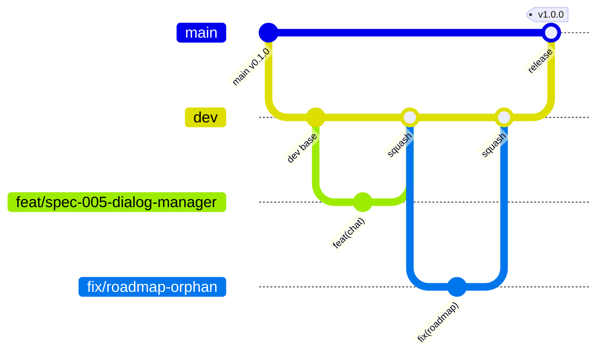

# Git Workflow

> **Status:** Active | **Owner:** LearnFl0w | **Updated:** 2026-11-03

## Model

Two permanent branches and short-lived working branches.

| Branch | Purpose | Created from | Merged into | Rules |
|---|---|---|---|---|
| `main` | Releases and demo. Source of the cloud deployment. | permanent | permanent | Protected. PRs only from `dev` (or a critical `fix/`). Every release gets a `vMAJOR.MINOR.PATCH` tag. |
| `dev` | Integration. Runs as the **local staging** environment. | `main` | `main` | Protected. PRs from working branches. Green CI + 1 approval. **Squash merge only.** |
| `feat/<topic>` | New feature (e.g. `feat/spec-005-dialog-manager`) | `dev` | `dev` | Short-lived (under 3 days). One task per branch. |
| `fix/<topic>` | Bug fix | `dev` (critical: `main`) | `dev` (critical: `main`, then back-merged into `dev`) | Include a test that reproduces the bug. |
| `chore/<topic>` | Tooling, dependencies, CI, docs, refactors | `dev` | `dev` | No behavior change. |

Documentation-only changes use `chore/docs-<topic>` and a `docs:` commit type.

## Daily Flow

1. `git switch dev && git pull`
2. `git switch -c feat/spec-005-dialog-manager`
3. Work in small commits (Conventional Commits). Run `make check` before pushing.
4. Open a PR **into `dev`** using the template. CI and `branch-policy` must pass.
5. The other team member reviews. Squash merge. Delete the branch.
6. Periodically run the integrated `dev` as local staging: `make staging-up && make smoke`.

## Release Flow

1. Gate reached (G2 on 2026-11-27 for the feature-complete release candidate).
2. Open a PR `dev` -> `main` (**merge commit**, not squash, to keep history). Required: green CI, staging smoke passed, checklist in PR description.
3. Tag the merge commit on `main`: `v0.x.y` during development, `v1.0.0` after Gate G3.
4. Cloud deployment runs from `main` **only during the deployment window (2026-11-28 to 2026-12-03)**, triggered manually (`workflow_dispatch`) or by a `v*` tag.

## Hotfix (critical issue on `main`)

1. Branch `fix/<topic>` from `main`, fix with a test.
2. PR into `main`, tag a patch release (e.g. `v1.0.1`), redeploy.
3. Back-merge: PR `main` -> `dev` from `chore/sync-main-into-dev`.

## Naming Rules (enforced by CI)

- Into `dev`: head branch must match `^(feat|fix|chore)/[a-z0-9._-]+$`.
- Into `main`: head must be `dev`, or `fix/...` for a critical hotfix.
- No direct pushes to `main` or `dev`.

## Commits

[Conventional Commits](https://www.conventionalcommits.org): `type(scope): description`.
Types: `feat`, `fix`, `docs`, `test`, `refactor`, `chore`, `ci`, `perf`. Imperative mood, under 72 characters.

## Pull Requests

- Link the spec or issue. Fill the template.
- Required: green CI, one approval from the other team member, docs updated.
- Squash into `dev`: the PR title becomes the commit message (Conventional Commits format).
- Keep PRs under about 400 changed lines where possible.

## Branch Protection (GitHub Settings)

| Setting | `dev` | `main` |
|---|---|---|
| Require pull request | Yes | Yes |
| Required approvals | 1 | 1 |
| Required status checks | `ci`, `branch-policy` | `ci`, `branch-policy` |
| Allowed merge methods | Squash | Merge commit |
| Force pushes / deletions | Blocked | Blocked |
| Require branches up to date | Yes | Yes |

## Environments and Branches

| Branch | Runs in | How |
|---|---|---|
| `feat/`, `fix/`, `chore/` | Local development | `make up` |
| `dev` | Local staging (production-like) | `make staging-up`, then `make smoke` |
| `main` | Cloud (GCP) | Deployment window only; see `docs/architecture/deployment.md` |

## Code Freeze

Code freeze on **2026-12-04** (Gate G3). After that, only critical fixes with a described risk and a rollback plan, via `fix/` into `main`.

## AI-Assisted Changes

- One task per OpenCode session, branch from `dev`, use the Plan agent first.
- Review the full diff yourself. The author of the PR owns the result.
- Never paste secrets into prompts.
