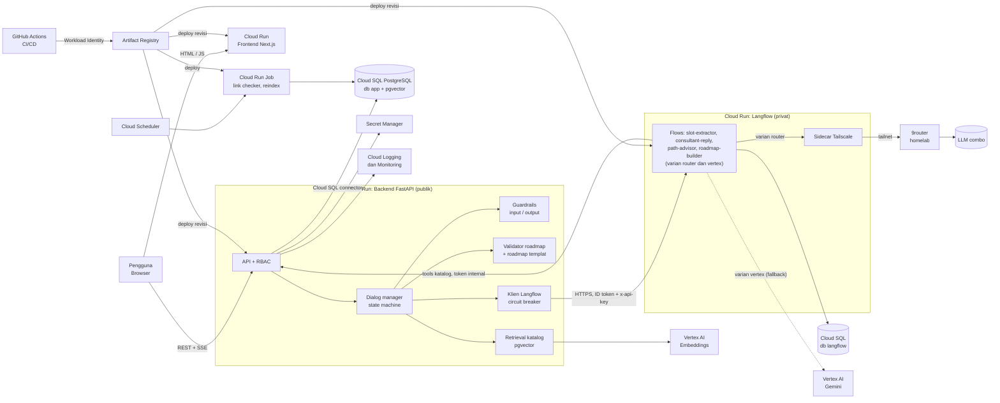
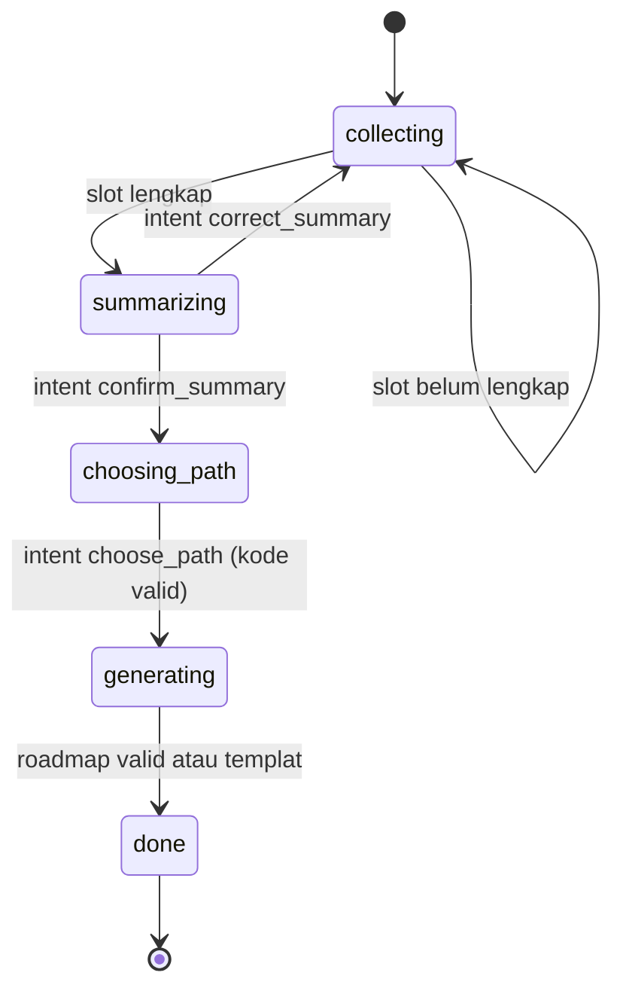
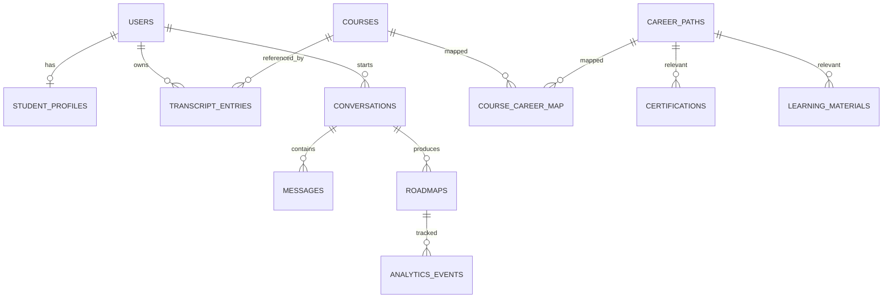
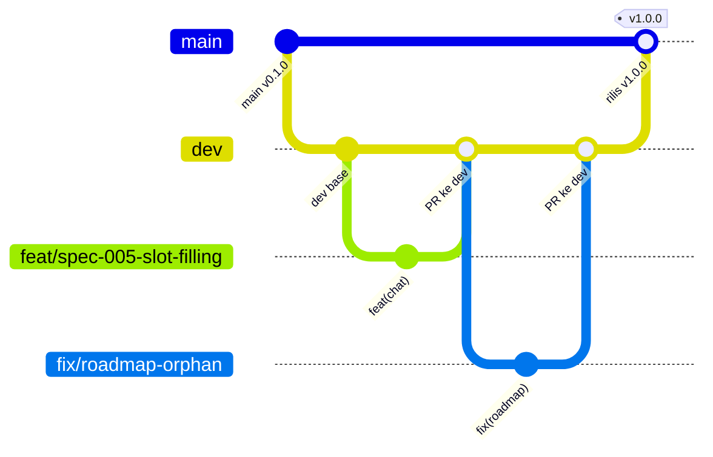

# Product Requirements Document (PRD)

# IT Career Compass

> Platform pemetaan karir berbasis Agentic AI untuk mahasiswa Teknologi Informasi

| Atribut | Nilai |
|---|---|
| Versi dokumen | 0.5 (Revisi 5) |
| Tanggal | 31 Oktober 2026 |
| Status | Draft revisi 2, siap menjadi acuan pengembangan |
| Tim | **LearnFl0w** (Anaya dan Bastian) |
| Jenis proyek | Tugas UAS mata kuliah Cloud Computing (kelompok 2 orang), tenggat **8 Desember 2026** |

## Daftar Isi

1. [Document Overview](#01--document-overview)
2. [Product Vision & Business Objectives](#02--product-vision--business-objectives)
3. [Product Scope](#03--product-scope)
4. [User Roles & Access](#04--user-roles--access)
5. [System Architecture](#05--system-architecture)
6. [End-to-End Customer Journey](#06--end-to-end-customer-journey)
7. [Functional Requirements](#07--functional-requirements)
8. [AI & LangChain System Requirements](#08--ai--langchain-system-requirements)
9. [Data Requirements](#09--data-requirements)
10. [Roles & Permission Matrix](#10--roles--permission-matrix)
11. [Integration Requirements](#11--integration-requirements)
12. [Notification Requirements](#12--notification-requirements)
13. [Reporting & Dashboard](#13--reporting--dashboard)
14. [Non-Functional Requirements](#14--non-functional-requirements)
15. [Acceptance Criteria](#15--acceptance-criteria)
16. [MVP Prioritization](#16--mvp-prioritization)
17. [Out of Scope V1](#17--out-of-scope-v1)
18. [Dependencies, Risks & Decision Log](#18--dependencies-risks--decision-log)
19. [Team Structure & Ownership](#19--team-structure--ownership)
20. [Milestones, Timeline & Release Plan](#20--milestones-timeline--release-plan)

---

## 01 | Document Overview

### 1.1 Tujuan Dokumen

Dokumen ini mendefinisikan kebutuhan produk **IT Career Compass** versi 1 (V1): konteks masalah, ruang lingkup, kebutuhan fungsional dan non-fungsional, desain AI, arsitektur, data, risiko, serta rencana rilis. Dokumen menjadi acuan tunggal bagi kedua anggota tim dan bahan pendukung laporan UAS.

### 1.2 Informasi Dokumen

| Item | Keterangan |
|---|---|
| Nama produk | IT Career Compass |
| Pemilik produk | Tim **LearnFl0w** (2 orang) |
| Penyusun | Anaya (Backend, AI & Deployment) dan Bastian (Frontend) |
| Tenggat | 8 Desember 2026 (UAS Cloud Computing) |
| Pengguna sasaran | Mahasiswa Program Studi Teknologi Informasi |
| Bahasa produk | Bahasa Indonesia |
| Platform | Web (responsif untuk desktop dan mobile browser) |

### 1.3 Riwayat Revisi

| Versi | Tanggal | Perubahan | Penulis |
|---|---|---|---|
| 0.1 | 31 Okt 2026 | Draft awal berdasarkan hasil diskusi scope | Tim |
| 0.2 | 31 Okt 2026 | Dua peran produk (Mahasiswa, Admin); arsitektur serverless GCP; tenggat 8 Des 2026; tanpa kode matkul resmi; penegasan keandalan cloud; nama tim LearnFl0w | LearnFl0w |
| 0.3 | 31 Okt 2026 | Autentikasi diganti menjadi login internal (email + password, JWT); penyesuaian Bagian 5, 7, 9, 11, 14, 18 | LearnFl0w |
| 0.4 | 3 Nov 2026 | Lapisan AI diganti ke **Langflow + FastAPI** (menggantikan kode LangChain/LangGraph kustom); penyesuaian Bagian 5, 8, 9, 11, 14 sampai 20 | LearnFl0w |
| 0.5 | 3 Nov 2026 | **Deployment dipindah ke akhir** (28 Nov sampai 3 Des); pengembangan dan staging di lokal; strategi branching `main`, `dev`, `feat/`, `fix/`, `chore/`; timeline dan gate disesuaikan | LearnFl0w |

### 1.4 Ringkasan Keputusan Kunci

Keputusan berikut sudah disepakati dalam diskusi dan menjadi dasar seluruh dokumen.

- Cakupan **satu kampus**, Program Studi Teknologi Informasi. Prioritas pengguna: **mahasiswa semester 5**; semester awal bersifat opsional.
- Konsultasi AI bersifat **hybrid**: alur terarah (slot-filling) dengan bahasa natural, tetap dalam tujuan pemetaan karir.
- Tool agent V1: **pencari sertifikasi**, **pencari materi belajar**, dan **pembuat roadmap**. Tool lain (misalnya tren pasar kerja) ditunda.
- Roadmap berbentuk **diagram node-edge** interaktif.
- Data kurikulum: mata kuliah semester 1 sampai 5 yang pernah ditempuh pembuat. Personalisasi melalui **transkrip** (input manual atau CSV; parsing PDF ditunda ke V2).
- Daftar jalur karir **baku** (bukan terbuka).
- Pengembangan **fully Dockerized**. **Pengembangan dan staging berjalan di lokal** (Docker Compose); **deployment ke Google Cloud Platform (serverless, Cloud Run) dilakukan di akhir** (28 Nov sampai 3 Des 2026) memakai kredit gratis. Alasan, risiko, dan mitigasinya ada di Bagian 20.1.
- Strategi branching: `main` (rilis dan sumber deployment), `dev` (integrasi dan staging lokal), serta cabang kerja `feat/`, `fix/`, `chore/` (Bagian 20.4).
- Hanya **dua peran produk**: **Mahasiswa** dan **Admin**. Peran dosen dan Kaprodi tidak diadakan.
- Tidak memakai kode mata kuliah resmi kampus; katalog memakai ID internal.
- Tenggat UAS: **8 Desember 2026**.
- **Prasyarat utama:** sistem harus berjalan di cloud dengan baik, benar, dan lancar tanpa hambatan (lihat 14.6).
- Fallback LLM otomatis ke **Vertex AI** agar layanan tetap hidup bila homelab tidak terjangkau.
- Lapisan AI memakai **Langflow** (flow visual, layanan privat) yang dipanggil oleh **FastAPI**. Dialog manager, validasi, guardrails, dan roadmap templat tetap di FastAPI (deterministik dan dapat diuji).
- Langflow mengakses LLM melalui **9router** (homelab, via **Tailscale**); setiap flow punya varian **Vertex AI** sebagai fallback otomatis.
- Monetisasi belum dipikirkan dan ditetapkan di luar scope V1.

### 1.5 Asumsi

| ID | Asumsi | Dampak jika salah |
|---|---|---|
| A-01 | 9router menyediakan endpoint kompatibel OpenAI (`/v1/chat/completions`) dengan model "combo" milik sendiri | Perlu adapter atau beralih ke API langsung |
| A-02 | Homelab dan koneksi Tailscale cukup stabil selama masa pengembangan dan demo | Fallback ke penyedia LLM langsung (lihat Bagian 11) |
| A-03 | Kredit GCP (sekitar USD 300) cukup untuk Cloud Run, Cloud SQL, dan Vertex AI hingga 8 Des 2026 | Resource dikecilkan atau dimatikan di luar jam pilot dan demo |
| A-04 | Transkrip pengguna dapat disalin ke format CSV atau diinput manual | Perlu form input lebih sederhana |
| A-05 | Skala nilai transkrip memakai huruf (A, AB, B, BC, C, D, E) | Daftar nilai disesuaikan lewat konfigurasi |
| A-06 | Tailscale dapat berjalan sebagai sidecar pada layanan **Langflow** di Cloud Run (userspace networking) | Varian flow Vertex AI menjadi jalur LLM utama |
| A-07 | Admin cukup 1 sampai 2 orang (anggota tim) yang ditetapkan lewat allowlist email | Perlu UI manajemen peran (di luar V1) |
| A-08 | Langflow (versi dipin) dapat berjalan stabil sebagai layanan privat di Cloud Run dan dapat dipanggil lewat API `run` | Divalidasi pada jendela deployment (M5); perkiraan sumber daya awal dari uji lokal (`docker stats`) |

### 1.6 Glosarium

| Istilah | Definisi |
|---|---|
| Agentic AI | Sistem LLM yang dapat merencanakan langkah dan memanggil tool secara mandiri untuk mencapai tujuan |
| RAG | *Retrieval-Augmented Generation*: LLM menjawab dengan konteks yang diambil dari basis data terkurasi |
| Slot-filling | Teknik percakapan yang memastikan sejumlah informasi wajib terkumpul sebelum proses lanjut |
| Roadmap | Peta karir berbentuk graf: tahapan, mata kuliah, materi, dan sertifikasi |
| Katalog | Kumpulan data terkurasi: mata kuliah, jalur karir, sertifikasi, materi belajar |
| Guardrails | Lapisan pengaman input dan output AI untuk mencegah halusinasi dan penyalahgunaan |
| Langflow | Platform visual untuk menyusun alur LLM (flow) yang dapat dipanggil lewat API |
| Flow | Satu alur Langflow, mis. `slot-extractor`; diekspor sebagai JSON dan disimpan di repositori |
| Dialog manager | Komponen FastAPI yang mengatur tahap konsultasi secara deterministik dan memutuskan flow yang dipanggil |
| Himpunan kandidat tertutup | Daftar item katalog yang disiapkan FastAPI; LLM hanya boleh memilih dari daftar ini |

---

## 02 | Product Vision & Business Objectives

### 2.1 Latar Belakang Masalah

Mahasiswa TI menghadapi kebingungan arah karir, terutama menjelang magang. Penyebabnya:

1. **Informasi melimpah tetapi tidak terhubung dengan kurikulum.** Roadmap umum di internet tidak menjelaskan mata kuliah mana di kampus yang relevan.
2. **Tidak ada panduan personal.** Mahasiswa tidak tahu jalur mana yang cocok dengan minat, nilai, dan skill saat ini.
3. **Tidak ada kejelasan sertifikasi dan materi.** Pilihan gratis dan berbayar tersebar dan sulit dinilai kualitasnya.
4. **Keputusan magang terlalu dekat.** Mahasiswa semester 5 perlu menentukan fokus skill untuk magang semester 6.

### 2.2 Visi Produk

> Menjadi kompas karir pertama bagi mahasiswa TI: dari "bingung mulai dari mana" menjadi roadmap personal yang terhubung dengan mata kuliah kampus, materi belajar, dan sertifikasi yang relevan.

### 2.3 Tujuan Bisnis dan Produk (V1)

| ID | Tujuan | Indikator Keberhasilan (target pilot) |
|---|---|---|
| O-1 | Membantu mahasiswa menentukan arah karir | ≥ 80% responden pilot memberi skor ≥ 4 dari 5 pada "roadmap membantu menentukan arah magang" |
| O-2 | Menghasilkan roadmap yang logis dan berbasis data terkurasi | 100% node pada roadmap berasal dari katalog (0 entitas fiktif) |
| O-3 | Sesi konsultasi efisien | Median waktu sesi sampai roadmap ≤ 15 menit |
| O-4 | Referensi dapat dipercaya | ≥ 95% tautan materi dan sertifikasi valid saat pilot |
| O-5 | Memenuhi tujuan akademik UAS | Arsitektur serverless cloud-native, Docker, CI/CD, dan deployment GCP dapat didemokan pada 8 Des 2026 |
| O-6 | Berjalan lancar di cloud | 0 insiden kritis dan 0 downtime selama pilot dan hari demo; respons pertama ≤ 5 detik tanpa pemanasan |

> Catatan: target pilot adalah usulan awal untuk 5 sampai 15 mahasiswa semester 5 dan dapat disesuaikan.

### 2.4 Prinsip Produk

- **Grounded first:** AI hanya merekomendasikan dari katalog terkurasi.
- **Personal tetapi ringkas:** pertanyaan seperlunya, hasil yang dapat ditindaklanjuti.
- **Terhubung kampus:** setiap tahapan dikaitkan dengan mata kuliah yang sudah atau belum ditempuh.
- **Transparan:** pengguna melihat alasan di balik setiap rekomendasi.
- **Privasi secara default:** data individu tidak diekspos, dashboard bersifat agregat.

---

## 03 | Product Scope

### 3.1 Fokus V1

**Konsultasi AI interaktif dan pembuatan roadmap karir**, didukung pencari sertifikasi dan materi belajar.

### 3.2 Dalam Scope (In Scope)

| Area | Cakupan |
|---|---|
| Autentikasi | Login pengguna dan pemisahan peran |
| Profil | Data akademik dasar, minat, skill, waktu belajar; transkrip via input manual atau CSV |
| Konsultasi AI | Percakapan hybrid berbasis slot-filling, streaming respons, riwayat sesi |
| Roadmap | Generate roadmap node-edge: tahapan, mata kuliah, materi, sertifikasi (gratis/berbayar) |
| Katalog | Mata kuliah (19 mata kuliah terkurasi), jalur karir baku, sertifikasi, materi belajar |
| Admin | Kelola katalog, dashboard tren agregat dan operasional |
| Platform | Docker, staging lokal, CI; deployment serverless di GCP (Cloud Run, Cloud SQL) pada fase akhir; pemantauan dan alert dasar |

### 3.3 Cakupan Kampus dan Pengguna

- Satu kampus, satu program studi (Teknologi Informasi).
- Pengguna utama: mahasiswa semester 5. Mahasiswa semester 1 sampai 4 dapat memakai dengan data yang lebih sedikit (opsional).

### 3.4 Jalur Karir Baku (Disetujui)

| Kode | Jalur Karir |
|---|---|
| CP-01 | Backend Developer |
| CP-02 | Frontend / Web Developer |
| CP-03 | Data Analyst |
| CP-04 | AI / Machine Learning Engineer |
| CP-05 | Cloud & DevOps Engineer |
| CP-06 | Network Engineer |
| CP-07 | Cybersecurity Analyst |
| CP-08 | IoT Engineer |
| CP-09 | UI/UX & Multimedia Designer |
| CP-10 | QA / Software Tester |
| CP-11 | Fintech / Banking IT Analyst |

### 3.5 Mata Kuliah Terkurasi

Dari 30 mata kuliah semester 1 sampai 5, **19 dipertahankan** untuk pemetaan dan **11 dikecualikan** karena tidak membantu membedakan jalur karir TI. Mata kuliah yang dikecualikan tetap diterima pada input transkrip tetapi diabaikan mesin pemetaan.

| Dikecualikan (11) | Alasan |
|---|---|
| Bahasa Inggris 1, 2, 3 | Kompetensi umum; ditampilkan sebagai tips umum, bukan node |
| Dasar Akuntansi, Kewirausahaan, Budaya Perusahaan | Non-teknis, tidak menunjuk jalur |
| Perbankan Syariah, Akuntansi Perbankan Syariah, Asset Liability Management Syariah | Domain keuangan non-TI |
| Pengantar TIK, Inovasi dan Teknologi Baru | Terlalu umum |

Daftar lengkap 19 mata kuliah dan pemetaannya ada di Bagian 9.

---

## 04 | User Roles & Access

Produk memiliki **dua peran**. Peran dosen dan Kaprodi tidak diadakan pada V1 (lihat DEC-016).

| Peran | Deskripsi | Tujuan Utama | Akses |
|---|---|---|---|
| **Mahasiswa** | Mahasiswa TI yang mengikuti konsultasi | Mendapat roadmap karir personal | Profil, transkrip, sesi, dan roadmap milik sendiri; katalog (baca) |
| **Admin** | Anggota tim LearnFl0w yang mengelola katalog dan memantau sistem | Menjaga akurasi katalog serta memantau tren dan kesehatan sistem | CRUD katalog, dashboard tren agregat dan operasional, laporan tautan rusak |

**Penetapan peran:** pengguna yang login pertama kali otomatis menjadi Mahasiswa. Peran Admin ditetapkan melalui *allowlist* email pada konfigurasi (Secret Manager atau environment variable).

### Persona Utama

**Mahasiswa Semester 5 (persona primer)**
- Konteks: harus menentukan fokus skill untuk magang semester 6.
- Masalah: banyak pilihan, tidak tahu jalur yang cocok, tidak tahu harus mulai dari mana.
- Kebutuhan: rekomendasi yang jelas, realistis terhadap waktu, dan terhubung dengan mata kuliah yang sudah ditempuh.

**Admin (persona sekunder)**
- Konteks: tim pengembang yang sekaligus kurator katalog.
- Kebutuhan: mengelola katalog dengan cepat, melihat tren jalur yang diminati, dan memastikan layanan sehat.
- Batasan: tidak melihat isi percakapan atau profil individu secara default.

---

## 05 | System Architecture

### 5.1 Prinsip Arsitektur

- **Serverless-first:** komputasi berjalan di Cloud Run (container, skala otomatis); tidak ada server yang dikelola.
- **Pembagian tanggung jawab:** **FastAPI** memegang data, aturan, dan validasi; **Langflow** memegang alur LLM (flow visual). Keputusan penting tidak diserahkan ke LLM.
- **Containerized:** satu Dockerfile per layanan (frontend, backend, Langflow); image sama di lokal dan cloud.
- **Stateless:** sumber kebenaran percakapan adalah PostgreSQL di FastAPI; flow tidak menyimpan state.
- **Managed services** untuk data, rahasia, dan log (Cloud SQL, Secret Manager, Cloud Logging).
- **Fallback LLM:** setiap flow punya varian `router` (9router) dan `vertex` (Vertex AI); *circuit breaker* di FastAPI memilih varian.
- **Keandalan lebih dulu:** setiap komponen punya health check, batas skala, dan jalur cadangan (lihat 14.6).
- **Deployment di akhir:** pengembangan dan staging berjalan di lokal (Docker Compose, profil `staging` yang meniru cloud); resource GCP dibuat pada jendela deployment 28 Nov sampai 3 Des (lihat 20.1).

### 5.2 Diagram Arsitektur



### 5.3 Komponen

| Komponen | Teknologi (usulan) | Tanggung Jawab |
|---|---|---|
| Frontend | Next.js (output standalone), TypeScript, **React Flow**; container di **Cloud Run** | UI chat (streaming), form profil/transkrip, viewer roadmap, panel admin, dashboard |
| Backend API | Python 3.12, FastAPI, SQLAlchemy, Alembic; container di **Cloud Run** | Auth, RBAC, REST/SSE, dialog manager, retrieval katalog, guardrails, validator roadmap, fallback templat, analitik |
| Langflow | Langflow (versi dipin), image kustom berisi flow; **Cloud Run privat** | Menjalankan flow LLM: ekstraksi slot, balasan konsultan, saran jalur, penyusunan roadmap |
| Sidecar Tailscale | Tailscale (userspace networking) pada layanan Langflow | Menjangkau 9router di homelab lewat tailnet |
| Database | **Cloud SQL for PostgreSQL 16 + pgvector**; satu instance, dua database (`app` dan `langflow`) | Data aplikasi, vektor katalog; metadata dan flow Langflow |
| Embedding | **Vertex AI** (embedding multibahasa), dipanggil dari backend | Embedding katalog dan query |
| LLM utama | 9router (homelab) via Tailscale, dipanggil dari flow varian `router` | Inferensi dengan model combo |
| LLM fallback | **Vertex AI (Gemini)**, dipanggil dari flow varian `vertex` memakai service account | Jalur cadangan tanpa homelab |
| Job terjadwal | **Cloud Run Jobs** + **Cloud Scheduler** | Pemeriksa tautan, reindex embedding, backup ekspor |
| CI/CD | GitHub Actions, Workload Identity Federation, Artifact Registry | Lint, uji, validasi flow, build, push, deploy revisi, smoke test, rollback |
| Rahasia dan observabilitas | Secret Manager, Cloud Logging, Cloud Monitoring, uptime check, Billing budget | Kredensial, log, alert, kontrol biaya |

### 5.4 Konfigurasi Cloud Run (Acuan Awal; Diukur pada Jendela Deployment)

| Parameter | Backend | Frontend | Langflow |
|---|---|---|---|
| Akses | Publik | Publik | **Privat** (hanya `sa-backend` sebagai invoker) |
| min-instances | 0 saat pengembangan; **1** pada 1 sampai 8 Des 2026 | 0; **1** pada 1 sampai 8 Des 2026 | 0 saat pengembangan; **1** pada 1 sampai 8 Des 2026 (wajib, startup berat) |
| max-instances | 3 | 3 | 2 |
| CPU | Always allocated | Request-based | Always allocated (sidecar Tailscale) |
| Memori | 1 GiB | 512 MiB | 2 GiB atau lebih (diukur) |
| Concurrency | 20 | 80 | 10 |
| Timeout request | 300 detik (SSE) | 60 detik | 300 detik |
| Health check | `/healthz` | `/api/health` | `/health_check` (siap bila database terjangkau) |
| Koneksi DB | Cloud SQL connector, pool kecil (maks 5) | tidak ada | Cloud SQL connector, database `langflow` |

Browser memanggil backend langsung; CORS dibatasi ke origin frontend. Langflow **tidak** dapat diakses dari internet; UI Langflow hanya dipakai developer secara lokal untuk menyusun flow.

### 5.5 Konektivitas LLM

| Opsi | Deskripsi | Pro | Kontra |
|---|---|---|---|
| **A: Tailscale sidecar pada Langflow (utama)** | Sidecar Tailscale di layanan Langflow; komponen model pada flow varian `router` menunjuk ke 9router lewat proxy lokal | Memakai API combo sendiri; homelab tidak terekspos publik | Konfigurasi lebih kompleks; butuh CPU always allocated; bergantung pada homelab |
| B: Tailscale Funnel (HTTPS publik) | 9router diekspos sementara lewat Funnel | Tanpa sidecar | Endpoint publik, perlu persetujuan pemilik homelab; keamanan lebih rendah |
| **C: Vertex AI (fallback otomatis)** | Flow varian `vertex` memanggil Gemini lewat service account | Paling andal, memakai kredit GCP, tanpa homelab | Bukan model combo sendiri |

**Strategi:** A sebagai jalur utama, **C sebagai fallback otomatis** lewat *circuit breaker* di FastAPI (lihat 8.8). Di lokal, varian `router` dan `vertex` sudah diuji sejak M1 (Tailscale terpasang di mesin pengembang). Konektivitas A dari **Cloud Run** dan stabilitas Langflow di Cloud Run divalidasi pada jendela deployment (M5). Bila gagal, **varian `vertex` menjadi jalur utama** dan 9router menjadi opsional (DEC-017).

### 5.6 Lingkungan dan Region

| Lingkungan | Platform | Tujuan |
|---|---|---|
| Local (pengembangan) | Docker Compose di mesin masing-masing (frontend, backend, Langflow, Postgres + pgvector; Tailscale opsional) | Pengembangan harian dan penyusunan flow; cabang `feat/`, `fix/`, `chore/` |
| **Staging lokal** | Docker Compose profil `staging` (image dan variabel meniru cloud) yang menjalankan cabang `dev` | Integrasi, evaluasi AI, UAT internal, gladi sebelum deployment |
| **Cloud (GCP)** | Cloud Run, Cloud SQL, Vertex AI; **dideploy di akhir** dari cabang `main` | Pilot dan demo 8 Des 2026 |

Region yang dituju: **asia-southeast2 (Jakarta)**; bila layanan tertentu (mis. model Vertex AI) belum tersedia, gunakan asia-southeast1 (Singapura). Ketersediaan diperiksa pada dokumentasi GCP sebelum M5. Tidak ada environment cloud terpisah untuk staging; staging dilakukan di lokal.

### 5.7 Alur Data Singkat (Satu Giliran Konsultasi)

1. Frontend mengirim pesan ke Backend (`POST /api/v1/sessions/{id}/messages`).
2. Backend memeriksa **input guardrails**, memuat profil, slot, tahap, dan beberapa pesan terakhir dari Cloud SQL.
3. Dialog manager memanggil flow **`slot-extractor`** (tanpa streaming) untuk memperbarui slot dan mendeteksi niat pengguna (setuju, koreksi, pilih jalur, di luar topik).
4. Dialog manager menentukan **aksi berikutnya** secara deterministik (tanyakan slot yang kurang, ringkas, tawarkan jalur, buat roadmap).
5. Untuk membalas, backend memanggil flow **`consultant-reply`** (streaming). Bila agent di flow membutuhkan data katalog, ia memanggil *tool* internal FastAPI (pencari sertifikasi dan materi) yang mengembalikan ID entitas.
6. Backend meneruskan token ke Frontend lewat SSE, sambil menyaring URL yang tidak berasal dari katalog.
7. Saat jalur dipilih: backend menyiapkan **himpunan kandidat tertutup** (matkul, sertifikasi, materi), memanggil flow **`roadmap-builder`**, lalu memvalidasi hasilnya (skema, graf, `ref_id`, personalisasi). Gagal dua kali berarti roadmap templat.
8. Backend menyimpan pesan, slot, tahap, roadmap, dan catatan `ai_runs`; Frontend menerima event `roadmap_ready`.

### 5.8 Keamanan Antar-Layanan

| Jalur | Mekanisme |
|---|---|
| Browser ke Backend | JWT akses berumur pendek, CORS terbatas |
| Backend ke Langflow | Cloud Run IAM (ID token service account) **dan** `x-api-key` Langflow |
| Langflow ke Backend (tools) | Header token internal (`X-Internal-Token`) dari Secret Manager; endpoint `/internal/*` tidak dipublikasikan di OpenAPI publik |
| Langflow ke LLM | Kunci model sebagai variabel global Langflow dari Secret Manager; Vertex AI memakai service account |
| Langflow (konfigurasi) | `LANGFLOW_AUTO_LOGIN=false`, secret key tetap, signup dimatikan |

---

## 06 | End-to-End Customer Journey

### 6.1 Journey Mahasiswa

| # | Tahap | Aksi Pengguna | Respons Sistem | Titik Risiko dan Penanganan |
|---|---|---|---|---|
| 1 | Login | Masuk dengan akun yang didukung | Membuat sesi, mengarahkan ke onboarding jika profil kosong | Login gagal: pesan jelas, opsi coba lagi |
| 2 | Onboarding profil | Mengisi semester, minat awal, waktu belajar per minggu, target magang | Menyimpan profil | Validasi form di sisi klien dan server |
| 3 | Input transkrip | Isi manual atau unggah CSV (mata kuliah dan nilai) | Memvalidasi terhadap katalog mata kuliah; mata kuliah di luar 19 terkurasi disimpan tetapi diabaikan | CSV tidak valid: laporan baris bermasalah |
| 4 | Konsultasi AI | Menjawab pertanyaan AI (minat, skill, gaya kerja, preferensi) | AI bertanya terarah, menyimpulkan, mengonfirmasi ringkasan profil | Jawaban di luar topik: AI mengarahkan kembali |
| 5 | Konfirmasi | Menyetujui ringkasan dan jalur yang dipertimbangkan | AI menawarkan 1 sampai 3 jalur teratas dengan alasan | Pengguna ragu: AI membandingkan jalur |
| 6 | Generate roadmap | Memilih jalur | Menampilkan status progres, membuat roadmap JSON tervalidasi | Gagal parsing: retry, lalu roadmap templat |
| 7 | Eksplorasi roadmap | Menelusuri node, melihat detail | Menampilkan matkul (sudah/belum ditempuh, nilai), materi, sertifikasi (gratis/berbayar) | Node tanpa data: ditandai jelas |
| 8 | Klik referensi | Membuka tautan materi atau sertifikasi | Mencatat klik, membuka di tab baru | Tautan rusak: pelaporan satu klik |
| 9 | Umpan balik | Memberi rating dan komentar | Menyimpan umpan balik | Opsional |
| 10 | Kembali nanti | Membuka riwayat, memperbarui roadmap | Menampilkan versi roadmap terakhir dan riwayat | |

### 6.2 Journey Admin (Ringkas)

- **Admin:** login, kelola katalog (tambah/ubah/nonaktifkan), jalankan pemeriksaan tautan, tinjau laporan tautan rusak, indeks ulang embedding, buka dashboard tren (agregat anonim) dan dashboard operasional.

---

## 07 | Functional Requirements

Prioritas: **M** = Must, **S** = Should, **C** = Could.

### 7.1 Autentikasi dan Akun (AUTH)

| ID | Kebutuhan | Prioritas |
|---|---|---|
| FR-AUTH-01 | Sistem menyediakan registrasi dan login dengan email dan password (modul auth internal, tabel `users`); password disimpan sebagai hash Argon2id | M |
| FR-AUTH-02 | Sistem menetapkan peran (Mahasiswa, Admin) dan menegakkan RBAC pada setiap endpoint | M |
| FR-AUTH-03 | Sesi memakai token berumur pendek dengan mekanisme refresh | M |
| FR-AUTH-04 | Pengguna dapat keluar dan menghapus akun beserta datanya | S |
| FR-AUTH-05 | Peran Admin ditetapkan melalui allowlist email pada konfigurasi; pengguna lain otomatis Mahasiswa | M |

### 7.2 Profil dan Transkrip (PRO)

| ID | Kebutuhan | Prioritas |
|---|---|---|
| FR-PRO-01 | Pengguna mengisi profil: semester, minat awal, skill saat ini, waktu belajar per minggu, target magang | M |
| FR-PRO-02 | Pengguna memasukkan transkrip manual (pilih mata kuliah dari katalog, isi nilai) | M |
| FR-PRO-03 | Pengguna mengunggah transkrip CSV dengan templat yang disediakan; sistem memvalidasi dan menampilkan pratinjau sebelum simpan | M |
| FR-PRO-04 | Mata kuliah di luar 19 terkurasi disimpan dengan penanda `is_mappable = false` dan tidak dipakai mesin pemetaan | M |
| FR-PRO-05 | Pengguna dapat mengubah profil dan transkrip; perubahan memicu tawaran memperbarui roadmap | S |
| FR-PRO-06 | Parsing transkrip PDF | Out of scope V1 |

### 7.3 Konsultasi AI (CHAT)

| ID | Kebutuhan | Prioritas |
|---|---|---|
| FR-CHAT-01 | Pengguna memulai sesi konsultasi baru atau melanjutkan sesi yang belum selesai | M |
| FR-CHAT-02 | Agent mengumpulkan slot wajib: minat, skill saat ini, preferensi gaya kerja, ketersediaan waktu, target magang; mengisi otomatis dari profil dan transkrip bila ada | M |
| FR-CHAT-03 | Respons di-*stream* (SSE) dengan indikator mengetik dan status pemanggilan tool | M |
| FR-CHAT-04 | Agent menampilkan ringkasan profil hasil konsultasi dan meminta konfirmasi sebelum membuat roadmap | M |
| FR-CHAT-05 | Agent menawarkan 1 sampai 3 jalur dari daftar baku beserta alasan | M |
| FR-CHAT-06 | Agent menolak dan mengarahkan kembali pertanyaan di luar topik pemetaan karir | M |
| FR-CHAT-07 | Pengguna dapat menghentikan, mengulang, atau mengulang dari awal sesi | S |
| FR-CHAT-08 | Batas panjang sesi dan pesan (lihat Bagian 8) | M |
| FR-CHAT-09 | Tombol saran jawaban cepat (*quick replies*) | C |

### 7.4 Roadmap (MAP)

| ID | Kebutuhan | Prioritas |
|---|---|---|
| FR-MAP-01 | Sistem membuat roadmap dari output JSON terstruktur yang divalidasi terhadap skema | M |
| FR-MAP-02 | Roadmap ditampilkan sebagai diagram node-edge interaktif (zoom, pan, klik node) | M |
| FR-MAP-03 | Node bertipe: `stage`, `course`, `material`, `certification`; edge menunjukkan prasyarat atau urutan | M |
| FR-MAP-04 | Node mata kuliah menampilkan semester, status (sudah ditempuh, belum, tidak ada) dan nilai bila ada | M |
| FR-MAP-05 | Node sertifikasi menampilkan penyedia, biaya (gratis/berbayar), tingkat, dan tautan | M |
| FR-MAP-06 | Node materi menampilkan judul, format, bahasa, durasi, tingkat, dan tautan | M |
| FR-MAP-07 | Setiap rekomendasi menampilkan alasan singkat ("mengapa ini?") | S |
| FR-MAP-08 | Tahapan disesuaikan dengan waktu belajar per minggu dan target magang | M |
| FR-MAP-09 | Penanda progres: pengguna menandai node selesai | S |
| FR-MAP-10 | Roadmap berversi; pengguna melihat versi sebelumnya | S |
| FR-MAP-11 | Ekspor roadmap sebagai gambar atau PDF | C |
| FR-MAP-12 | Roadmap templat per jalur sebagai cadangan bila generasi AI gagal | M |

### 7.5 Pencari Sertifikasi dan Materi (CAT)

| ID | Kebutuhan | Prioritas |
|---|---|---|
| FR-CAT-01 | Pengguna mencari dan memfilter sertifikasi (jalur, biaya, tingkat, penyedia) di luar sesi | S |
| FR-CAT-02 | Pengguna mencari dan memfilter materi belajar (jalur, format, bahasa, tingkat, gratis/berbayar) | S |
| FR-CAT-03 | Tombol "laporkan tautan rusak" pada setiap referensi | S |
| FR-CAT-04 | Klik referensi dicatat untuk analitik | M |

### 7.6 Administrasi Katalog (ADM)

| ID | Kebutuhan | Prioritas |
|---|---|---|
| FR-ADM-01 | Admin mengelola (CRUD) mata kuliah, jalur karir, pemetaan matkul ke jalur | M |
| FR-ADM-02 | Admin mengelola sertifikasi dan materi belajar, termasuk status aktif dan tanggal verifikasi terakhir | M |
| FR-ADM-03 | Setiap perubahan katalog memicu pengindeksan ulang embedding | M |
| FR-ADM-04 | Impor katalog massal dari CSV | S |
| FR-ADM-05 | Pemeriksa tautan terjadwal; tautan mati otomatis ditandai untuk ditinjau | S |
| FR-ADM-06 | Tinjau laporan tautan rusak dan umpan balik pengguna | S |
| FR-ADM-07 | Log audit untuk perubahan katalog | S |

### 7.7 Riwayat dan Umpan Balik (HIS)

| ID | Kebutuhan | Prioritas |
|---|---|---|
| FR-HIS-01 | Pengguna melihat daftar sesi dan roadmap sebelumnya | M |
| FR-HIS-02 | Pengguna memberi rating (1 sampai 5) dan komentar pada sesi dan roadmap | M |
| FR-HIS-03 | Pengguna menghapus sesi atau data percakapannya | S |


---

## 08 | AI & LangChain System Requirements

> Lapisan AI dibangun di atas ekosistem LangChain melalui **Langflow** (flow visual) yang dipanggil oleh **FastAPI**. Tidak ada kode agent LangChain/LangGraph kustom di backend (DEC-020).

### 8.1 Prinsip Desain AI

1. **Grounded, himpunan tertutup:** FastAPI menyiapkan daftar kandidat dari katalog; LLM hanya memilih, mengurutkan, dan menjelaskan. LLM tidak boleh membuat entitas atau tautan baru.
2. **Terstruktur:** roadmap adalah JSON yang divalidasi terhadap skema.
3. **Terkendali:** tahap konsultasi diatur **dialog manager deterministik** di FastAPI, bukan oleh LLM.
4. **Dapat diganti:** setiap flow punya varian `router` dan `vertex`; pemilihan lewat konfigurasi dan circuit breaker.
5. **Terukur:** ada set evaluasi persona yang dijalankan pada setiap perubahan flow.

### 8.2 Pembagian Tanggung Jawab

| Dikerjakan di FastAPI (kode, deterministik) | Dikerjakan di Langflow (flow, LLM) |
|---|---|
| Autentikasi, RBAC, batas pemakaian | Ekstraksi slot dan deteksi niat (`slot-extractor`) |
| Dialog manager (tahap dan transisi) | Balasan percakapan berbahasa Indonesia (`consultant-reply`) |
| Input dan output guardrails | Saran 1 sampai 3 jalur beserta alasan (`path-advisor`) |
| Retrieval katalog (pgvector) dan himpunan kandidat tertutup | Penyusunan roadmap dari kandidat (`roadmap-builder`) |
| Validasi roadmap, roadmap templat, penyimpanan versi | Pemanggilan model (9router atau Vertex AI) |
| Circuit breaker, timeout, pemilihan varian flow | Pemanggilan tool katalog (lewat endpoint internal FastAPI) |
| Persistensi pesan, slot, tahap, `ai_runs` | Prompt dan parameter model (dalam flow) |

### 8.3 Flow Langflow (V1)

Setiap flow memiliki dua varian yang diberi nama `<flow>__router` dan `<flow>__vertex`. Flow **tanpa state**: konteks dikirim FastAPI pada setiap panggilan.

| Flow | Mode | Input | Output | Temperature | Tool |
|---|---|---|---|---|---|
| `slot-extractor` | Non-stream | Pesan terbaru + beberapa pesan terakhir + slot saat ini | JSON: `slots_update`, `intent`, `chosen_path` | 0.0 sampai 0.1 | Tidak ada |
| `consultant-reply` | **Stream** | Tahap, slot terisi, slot kurang, **instruksi** dari dialog manager | Teks Indonesia (tanpa URL) | 0.4 | `certification_finder`, `material_finder` |
| `path-advisor` | Non-stream | Slot + kandidat jalur hasil peringkat FastAPI | JSON: 1 sampai 3 `{code, reason}` | 0.2 | Tidak ada |
| `roadmap-builder` | Non-stream | Jalur + slot + **himpunan kandidat tertutup** | Roadmap JSON | 0.2 | Tidak ada |

Nilai `intent`: `provide_info`, `confirm_summary`, `correct_summary`, `choose_path`, `ask_question`, `off_topic`.

### 8.4 Dialog Manager (FastAPI)



**Slot wajib:** `interests`, `current_skills`, `work_style`, `hours_per_week`, `internship_target`, `budget_pref`. Slot yang sudah ada di profil atau transkrip diisi otomatis dan hanya dikonfirmasi.

**Algoritma per giliran:**
1. Jalankan input guardrails dan batas pemakaian.
2. Panggil `slot-extractor`; validasi keluaran dengan Pydantic; gabungkan slot.
3. Hitung aksi berikutnya (`ask:<slot>`, `summarize`, `offer_paths`, `answer_question`, `redirect`, `generate_roadmap`) dari tahap, slot, dan `intent`. Logika ini **murni kode** dan diuji unit.
4. Untuk `offer_paths`: FastAPI meranking jalur kandidat (kemiripan slot dengan deskripsi jalur dan pemetaan matkul), memanggil `path-advisor`, lalu **memverifikasi bahwa setiap `code` ada pada daftar baku**.
5. Panggil `consultant-reply` dengan instruksi aksi; alirkan token ke pengguna.
6. Simpan pesan, slot, tahap, dan catatan `ai_runs`.

Batas: 25 giliran per sesi; 5 sesi per hari per pengguna.

### 8.5 Tools dan RAG

**Tool untuk agent di `consultant-reply`** (endpoint internal FastAPI, hanya baca):

| Tool | Fungsi | Sumber |
|---|---|---|
| `certification_finder` | Cari sertifikasi sesuai jalur, tingkat, biaya | pgvector + filter metadata |
| `material_finder` | Cari materi sesuai jalur, tahap, format, bahasa | pgvector + filter metadata |

Keduanya mengembalikan **ID entitas** dan kolom tampilan. Pencarian mata kuliah dan pembuatan roadmap **tidak** dilakukan agent: FastAPI menyiapkan himpunan kandidat tertutup untuk `roadmap-builder`. Tool tren pasar kerja ditunda ke V2.

| Aspek | Ketentuan |
|---|---|
| Vector store | **Cloud SQL for PostgreSQL + pgvector**. Data kecil sehingga pencarian eksak cukup; indeks HNSW opsional |
| Koleksi | `courses`, `career_paths`, `certifications`, `learning_materials` |
| Unit dokumen | Satu entitas katalog = satu dokumen (50 sampai 150 kata) |
| Embedding | **Vertex AI** (mis. `text-multilingual-embedding-002`; verifikasi ketersediaan di region), dipanggil dari backend; versi model disimpan per baris |
| Retrieval | Filter metadata (jalur, biaya, tingkat, `status = active`) + top-k (5 sampai 8) |
| Reindex | Otomatis saat katalog berubah (FR-ADM-03) |
| Sumber tautan | Hanya kolom `url` katalog |

### 8.6 Guardrails dan Anti-Halusinasi

**Input (FastAPI)**

| Kontrol | Perilaku |
|---|---|
| Sanitasi | Batas panjang, pembersihan karakter kontrol, deteksi data sensitif |
| Anti prompt injection | Pesan pengguna dan data transkrip diperlakukan sebagai data; heuristik dan instruksi pada flow |
| Topik | Niat `off_topic` dijawab singkat lalu diarahkan kembali |
| Rate limit | Per pengguna dan per sesi |

**Output (FastAPI)**

| Kontrol | Perilaku |
|---|---|
| Himpunan tertutup | Roadmap hanya boleh memuat `ref_id` dari daftar kandidat yang diberikan |
| Validasi skema | Roadmap lolos JSON Schema dan model Pydantic |
| Verifikasi ID dan tautan | Setiap `ref_id` ada di katalog dan `status = active`; URL hanya dari katalog |
| Aturan graf | DAG, tanpa node yatim, urutan fondasi ke lanjutan |
| Aturan personalisasi | Matkul yang sudah ditempuh tidak direkomendasikan sebagai tugas baru; preferensi biaya dihormati |
| Filter aliran teks | URL pada balasan streaming yang tidak berasal dari katalog dihapus; referensi ditampilkan sebagai kartu dari hasil tool |
| Larangan klaim | Tidak menjanjikan gaji, lowongan, atau kelulusan |
| "Tidak tahu" | Bila data tidak ada, nyatakan keterbatasan dan tawarkan alternatif katalog |

**Fallback roadmap:** bila validasi gagal setelah 2 percobaan, sistem memakai **roadmap templat jalur** (dikurasi Admin) yang dipersonalisasi secara deterministik.

### 8.7 Structured Output (Roadmap JSON)

Keluaran `roadmap-builder` mengikuti `docs/api/roadmap.schema.json`. Pada flow, komponen keluaran terstruktur dipakai; di FastAPI, hasil diparse dan divalidasi dengan Pydantic. Perbaikan otomatis dilakukan dengan memanggil ulang flow (maksimal 2 kali) membawa daftar kesalahan validasi.

```json
{
  "schema_version": "1.0",
  "career_path_code": "CP-05",
  "summary": "Ringkasan alasan jalur dipilih",
  "assumptions": { "hours_per_week": 8, "internship_target": "Semester 6", "budget": "free" },
  "stages": [
    { "id": "S1", "title": "Fondasi Linux dan Jaringan", "order": 1, "estimated_weeks": 3 }
  ],
  "nodes": [
    { "id": "N1", "type": "course", "ref_id": "MK-SO", "stage_id": "S1",
      "label": "Sistem Operasi", "status": "completed", "grade": "A",
      "reason": "Dasar administrasi Linux" },
    { "id": "N2", "type": "certification", "ref_id": "CERT-012", "stage_id": "S3",
      "label": "Nama sertifikasi dari katalog", "cost_type": "free",
      "reason": "Validasi kompetensi cloud dasar" },
    { "id": "N3", "type": "material", "ref_id": "MAT-044", "stage_id": "S1",
      "label": "Judul materi dari katalog", "cost_type": "free", "reason": "Latihan praktik" }
  ],
  "edges": [
    { "from": "N1", "to": "N2", "relation": "prerequisite" }
  ],
  "general_tips": ["Latih bahasa Inggris teknis"]
}
```

**Aturan skema:** graf harus *acyclic* (DAG), tidak ada node yatim (kecuali node akar), setiap node punya `stage_id` valid, setiap `ref_id` ada di katalog, `status` salah satu dari `completed | in_progress | not_taken | not_applicable`.

### 8.8 Varian Flow, Fallback, dan Batasan

| Parameter | Ketentuan |
|---|---|
| Pemilihan varian | `LLM_PROVIDER` = `router` (default) atau `vertex`; menentukan varian flow yang dipanggil FastAPI |
| Fallback | `LLM_FALLBACK_PROVIDER` = `vertex`; dipakai otomatis saat circuit breaker terbuka |
| Circuit breaker | Per varian; terbuka setelah 3 kegagalan beruntun; dicoba kembali setiap 60 detik |
| Timeout dan retry | Timeout 30 detik per panggilan flow non-stream (60 detik untuk `roadmap-builder`); retry eksponensial maksimal 2 kali |
| Streaming | Wajib untuk `consultant-reply`; FastAPI memetakan event Langflow ke event SSE kita |
| Batas sesi | Maks 25 giliran, 5 sesi per hari per pengguna, konteks dikirim ke flow dibatasi pada pesan terakhir (jendela) |
| Model | Dikonfigurasi pada komponen model di tiap flow; kunci disimpan sebagai variabel global Langflow dari Secret Manager |

### 8.9 Pengelolaan Flow

| Aspek | Ketentuan |
|---|---|
| Penyusunan | Secara lokal pada Langflow (Docker Compose); UI tidak diekspos di cloud |
| Versi | Flow diekspor sebagai JSON ke `langflow/flows/` dan di-*review* lewat pull request |
| Penerapan | Image Langflow kustom memuat flow dari repositori; versi Langflow **dipin** |
| Paritas varian | CI memeriksa bahwa setiap flow memiliki varian `router` dan `vertex` dengan antarmuka input/output yang sama |
| Rahasia | Tidak boleh ada kunci pada JSON flow; semua lewat variabel global |
| Perubahan prompt | Perubahan flow wajib menjalankan evaluasi persona |

### 8.10 Evaluasi dan Observabilitas AI

| Aspek | Metode | Target |
|---|---|---|
| Validitas skema | Uji otomatis pada 20 persona sintetis | ≥ 98% |
| Grounding | Verifikasi ID dan tautan terhadap katalog | 100% |
| Kelogisan urutan | Cek DAG dan urutan fondasi ke lanjutan | 100% lolos aturan |
| Dialog manager | Uji unit untuk semua transisi tahap | 100% cabang |
| Relevansi jalur | Penilaian manual oleh tim (rubrik 1 sampai 5) | rata-rata ≥ 4 |
| Ketahanan | Uji adversarial (prompt injection, di luar topik) | 100% ditangani |
| Observabilitas | Tabel `ai_runs` (flow, varian, durasi, token, fallback, status) tanpa isi pesan; log terstruktur | Ada |

---

## 09 | Data Requirements

### 9.1 Ringkasan Entitas



### 9.2 Profil Mahasiswa (`users`, `student_profiles`)

| Tabel.Kolom | Tipe | Keterangan |
|---|---|---|
| users.id | UUID, PK | |
| users.email | text, unik | Email untuk login |
| users.password_hash | text | Hash Argon2id; tidak pernah dikembalikan oleh API |
| users.role | enum | `student`, `admin` |
| users.created_at | timestamptz | |
| student_profiles.user_id | UUID, FK | |
| student_profiles.display_name | text | Opsional |
| student_profiles.semester | smallint | 1 sampai 8 |
| student_profiles.interests | text[] | Minat awal |
| student_profiles.current_skills | text[] | Skill saat ini |
| student_profiles.work_style | text | Hasil konsultasi |
| student_profiles.hours_per_week | smallint | Waktu belajar |
| student_profiles.internship_target | text | Mis. "Semester 6" |
| student_profiles.budget_pref | enum | `free`, `paid_ok` |
| student_profiles.consent_at | timestamptz | Persetujuan pemrosesan data |

> NIM tidak disimpan pada V1 untuk meminimalkan data pribadi.

### 9.3 Transkrip (`transcript_entries`)

| Kolom | Tipe | Keterangan |
|---|---|---|
| id | UUID, PK | |
| user_id | UUID, FK | |
| course_id | UUID, FK | Ke `courses` |
| grade_letter | enum | A, AB, B, BC, C, D, E (asumsi A-05) |
| semester_taken | smallint | |
| source | enum | `manual`, `csv` |

**Templat CSV:** `nama_matkul,nilai,semester` (nama dicocokkan ke katalog; bila tidak persis sama, sistem menawarkan pilihan terdekat)

### 9.4 Riwayat Percakapan (`conversations`, `messages`)

| Tabel.Kolom | Tipe | Keterangan |
|---|---|---|
| conversations.id | UUID, PK | |
| conversations.user_id | UUID, FK | |
| conversations.status | enum | `active`, `completed`, `abandoned` |
| conversations.slots | jsonb | Slot terkumpul |
| conversations.state | text | Tahap dialog manager: `collecting`, `summarizing`, `choosing_path`, `generating`, `done` |
| conversations.started_at / ended_at | timestamptz | |
| messages.id | UUID, PK | |
| messages.conversation_id | UUID, FK | |
| messages.role | enum | `user`, `assistant`, `tool`, `system` |
| messages.content | text | |
| messages.tool_calls | jsonb | Nama tool dan ID entitas, tanpa PII |
| messages.token_in / token_out | int | Untuk pemantauan biaya |
| messages.created_at | timestamptz | |

### 9.5 Database Mata Kuliah (`courses`, `course_career_map`)

| Kolom | Tipe | Keterangan |
|---|---|---|
| courses.id | UUID, PK | |
| courses.code | text, unik | Slug internal (mis. `MK-SO`); **bukan** kode resmi kampus |
| courses.name | text | |
| courses.semester | smallint | 1 sampai 5 pada V1 |
| courses.credits | smallint, nullable | Opsional; tidak dipakai pada V1 |
| courses.description | text | Topik utama; dasar embedding |
| courses.is_mappable | boolean | `false` untuk 11 matkul non-TI |
| courses.embedding | vector | |
| course_career_map.course_id / career_path_id | FK | |
| course_career_map.relevance | smallint | 1 sampai 3 (rendah sampai tinggi) |

**Seed 19 mata kuliah terkurasi dan pemetaan awal jalur (usulan):**

| Sem | Mata Kuliah | Jalur Terkait |
|---|---|---|
| 1 | Algoritma Pemrograman | CP-01, 02, 04, 10 |
| 2 | Basis Data | CP-01, 03, 04, 11 |
| 2 | Aljabar Linier | CP-03, 04 |
| 2 | Matematika Diskrit | CP-01, 04, 07 |
| 3 | Organisasi dan Arsitektur Komputer | CP-05, 06, 08 |
| 3 | Data Mining | CP-03, 04, 11 |
| 3 | Sistem Operasi | CP-05, 06, 07 |
| 3 | Komunikasi Data | CP-06, 07, 08 |
| 3 | Jaringan Komputer | CP-05, 06, 07 |
| 4 | Desain Grafis | CP-02, 09 |
| 4 | Rekayasa Perangkat Lunak | CP-01, 02, 10, 11 |
| 4 | Statistika | CP-03, 04 |
| 4 | IoT Concept | CP-06, 08 |
| 4 | Pemrograman Berbasis Objek | CP-01, 02, 10 |
| 5 | Cloud Computing | CP-05, 01 |
| 5 | E-Commerce | CP-02, 11 |
| 5 | Financial Technology | CP-11, 01, 07 |
| 5 | Cyber Security | CP-07, 05, 06 |
| 5 | Multimedia | CP-09, 02 |

> Pemetaan di atas disetujui sebagai seed awal dan dapat diubah Admin melalui panel admin.

### 9.6 Database Jalur Karir (`career_paths`)

| Kolom | Tipe | Keterangan |
|---|---|---|
| id / code | UUID / text | `CP-01` dan seterusnya |
| name | text | |
| description | text | Deskripsi peran dan skill inti |
| template_stages | jsonb | Templat roadmap cadangan |
| is_active | boolean | |
| embedding | vector | |

### 9.7 Database Sertifikasi (`certifications`)

| Kolom | Tipe | Keterangan |
|---|---|---|
| id | UUID, PK | Kode `CERT-xxx` |
| name | text | |
| provider | text | Penyedia/penerbit |
| level | enum | `beginner`, `intermediate`, `advanced` |
| cost_type | enum | `free`, `paid`, `freemium` |
| cost_estimate | numeric + currency | Opsional |
| url | text | Satu-satunya sumber tautan |
| career_path_ids | uuid[] | |
| description | text | |
| language | text | |
| last_verified_at | date | Terakhir diverifikasi |
| status | enum | `active`, `needs_review`, `inactive` |
| embedding | vector | |

### 9.8 Database Materi Belajar (`learning_materials`)

| Kolom | Tipe | Keterangan |
|---|---|---|
| id | UUID, PK | Kode `MAT-xxx` |
| title / provider | text | |
| format | enum | `video`, `article`, `course`, `book`, `lab` |
| level | enum | |
| cost_type | enum | `free`, `paid`, `freemium` |
| language | text | |
| duration_minutes | int | Opsional |
| url | text | |
| career_path_ids / topic_tags | array | |
| last_verified_at / status | date / enum | |
| embedding | vector | |

### 9.9 Roadmap dan Analitik

| Tabel | Kolom Utama |
|---|---|
| roadmaps | id, conversation_id, user_id, career_path_id, version, content (jsonb sesuai Bagian 8.6), source (`ai` / `template`), created_at |
| roadmap_progress | roadmap_id, node_id, completed_at |
| feedback | id, user_id, target_type, target_id, rating, comment, created_at |
| link_reports | id, entity_type, entity_id, reported_by, status |
| analytics_events | id, user_id (pseudonim), event_type, payload jsonb, created_at |
| ai_runs | id, conversation_id, flow_name, variant (`router` / `vertex`), status, latency_ms, tokens_in, tokens_out, fallback_used, created_at |
| audit_logs | id, actor_id, action, entity, before/after jsonb, created_at |

### 9.10 Kebijakan Data

| Aspek | Ketentuan |
|---|---|
| Retensi | Percakapan dan roadmap disimpan 12 bulan atau hingga dihapus pengguna |
| Penghapusan | Pengguna dapat menghapus data; penghapusan bersifat cascade |
| Anonimisasi analitik | Dashboard memakai ID pseudonim dan agregasi minimum 5 pengguna per sel (k-anonymity sederhana) |
| Kualitas data | Setiap sertifikasi dan materi memiliki `last_verified_at`; item tidak diverifikasi > 90 hari ditandai `needs_review` |
| Backup | Cloud SQL automated backup harian dan ekspor manual ke Cloud Storage sebelum hari demo |

---

## 10 | Roles & Permission Matrix

Keterangan: **C** = Create, **R** = Read, **U** = Update, **D** = Delete, **—** = tidak ada akses, **(own)** = hanya data milik sendiri, **(agg)** = hanya agregat anonim.

| Sumber Daya / Aksi | Mahasiswa | Admin |
|---|---|---|
| Profil | C, R, U, D (own) | — |
| Transkrip | C, R, U, D (own) | — |
| Sesi konsultasi dan pesan | C, R, D (own) | — |
| Roadmap | C, R, U progres, D (own) | — |
| Umpan balik | C, R (own) | R (agg) |
| Katalog mata kuliah | R | C, R, U, D |
| Katalog jalur karir | R | C, R, U, D |
| Katalog sertifikasi | R | C, R, U, D |
| Katalog materi belajar | R | C, R, U, D |
| Laporan tautan rusak | C | R, U |
| Reindex embedding | — | Ya |
| Dashboard tren karir | — | R (agg) |
| Dashboard operasional (latensi, biaya, error) | — | R |
| Ekspor CSV agregat | — | Ya |
| Log audit | — | R |
| Manajemen peran (allowlist Admin) | — | Melalui konfigurasi, bukan UI |
| Akses percakapan atau profil individu | Hanya milik sendiri | **Tidak** (kecuali investigasi insiden yang disepakati tim) |

---

## 11 | Integration Requirements

| ID | Integrasi | Tujuan | Protokol | Autentikasi | Penanganan Kegagalan |
|---|---|---|---|---|---|
| INT-01 | **Langflow** (layanan privat di Cloud Run) | Menjalankan flow LLM | HTTPS REST `POST /api/v1/run/{flow}` (streaming dengan `?stream=true`) | Cloud Run IAM (ID token) + header `x-api-key` | Timeout, retry 2 kali, circuit breaker per varian, beralih ke varian fallback |
| INT-02 | **9router (homelab)** dari Langflow | LLM utama (model combo) | API kompatibel OpenAI lewat **Tailscale sidecar** | API key 9router (variabel global Langflow dari Secret Manager) + ACL Tailscale | Circuit breaker memindahkan ke varian `vertex` |
| INT-03 | **Vertex AI (Gemini)** dari Langflow | Varian fallback flow; dapat menjadi jalur utama (DEC-017) | Vertex AI API | Service account Langflow berhak minimum | Pesan ramah bila fallback pun gagal; state sesi tidak hilang |
| INT-04 | **OpenAI / Anthropic** (opsional) | Cadangan tambahan lewat komponen model Langflow | HTTPS REST | API key di Secret Manager | Dinonaktifkan secara default |
| INT-05 | **Cloud SQL (database `app` + pgvector)** dari backend | Data aplikasi dan pencarian embedding | SQL melalui Cloud SQL connector | IAM / kredensial di Secret Manager | Retry; bila gagal, tool mengembalikan status "tidak tersedia" |
| INT-06 | **Cloud SQL (database `langflow`)** dari Langflow | Metadata dan flow Langflow | SQL (`LANGFLOW_DATABASE_URL`) | Kredensial di Secret Manager | Health check `/health_check` gagal berarti instance diganti |
| INT-07 | **Vertex AI Embeddings** dari backend | Embedding katalog dan query | Vertex AI API | Service account backend | Cache embedding katalog; retry; alternatif model ONNX |
| INT-08 | **Tool internal FastAPI** dari Langflow | Pencarian sertifikasi dan materi oleh agent | HTTPS `/internal/tools/*` | Header `X-Internal-Token` | Timeout pendek; flow menjawab "data tidak tersedia" |
| INT-09 | **Autentikasi internal** | Registrasi, login, identitas | Modul auth di backend (REST) | Hash Argon2id; JWT berumur pendek + refresh token berotasi | Pembatasan percobaan login |
| INT-10 | **GitHub Actions + Workload Identity Federation** | CI/CD tanpa kunci statis | Workflow dan OIDC | Federasi identitas ke service account GCP | Rollback ke revisi Cloud Run sebelumnya |
| INT-11 | **GCP: Cloud Run, Artifact Registry, Secret Manager, Cloud Logging/Monitoring, Cloud Scheduler** | Hosting serverless, registry, rahasia, observabilitas, job terjadwal | API GCP | Service account berhak minimum | Alert pada error deploy dan uptime |
| INT-12 | **Pemeriksa tautan** (Cloud Run Job) | Validasi URL katalog | HTTP HEAD/GET terjadwal | — | Tandai `needs_review` |
| INT-13 | **Observabilitas AI** (opsional) | Pelacakan trace tambahan | SDK Langfuse atau fitur bawaan | API key | Dapat dimatikan tanpa memengaruhi fungsi |

**Ketentuan umum integrasi:**
- Semua rahasia disimpan di Secret Manager, **tidak pernah** di repositori, image, atau JSON flow.
- Lapisan `LangflowClient` memisahkan logika bisnis dari Langflow; backend tidak memanggil LLM secara langsung.
- Verifikasi konektivitas lewat `/healthz` (aplikasi dan DB) dan `/healthz/llm` (Langflow dan status circuit tiap varian).
- Service account dipisah per layanan (frontend, backend, Langflow, job, CI/CD) dengan hak akses minimum.
- Versi Langflow dipin; peningkatan versi dilakukan lewat PR dengan menjalankan evaluasi persona.

---

## 12 | Notification Requirements

| ID | Notifikasi | Penerima | Kanal | Pemicu | Prioritas |
|---|---|---|---|---|---|
| NT-01 | Roadmap siap | Mahasiswa | In-app (toast + badge) | Roadmap selesai dibuat | M |
| NT-02 | Sesi tidak selesai | Mahasiswa | In-app | Sesi `active` tanpa aktivitas 24 jam (muncul saat login berikutnya) | S |
| NT-03 | Kesalahan sistem AI | Mahasiswa | In-app (pesan ramah) | Timeout atau kegagalan LLM | M |
| NT-04 | Tautan dilaporkan rusak | Admin | In-app dan webhook (Discord/Telegram) | Laporan pengguna atau pemeriksa tautan | S |
| NT-05 | Alert operasional | Tim pengembang | Webhook | Error rate > 5%, 9router tidak terjangkau, anggaran GCP > 80% | S |
| NT-06 | Ringkasan mingguan tren | Admin | Email | Jadwal mingguan | C |
| NT-07 | Pengingat memperbarui roadmap | Mahasiswa | Email | Katalog diperbarui signifikan atau 30 hari tanpa aktivitas | C |

Kebutuhan umum: notifikasi email (bila diaktifkan) memakai layanan email transaksional (dipilih bila fitur ini diaktifkan), memuat tautan berhenti berlangganan, dan tidak memuat data sensitif.

---

## 13 | Reporting & Dashboard

### 13.1 Dashboard Tren Karir (Admin)

| ID | Metrik / Visual | Deskripsi |
|---|---|---|
| RPT-01 | Jalur karir paling diminati | Bar chart jumlah sesi per jalur (dapat difilter periode dan semester) |
| RPT-02 | Tren jalur dari waktu ke waktu | Line chart mingguan |
| RPT-03 | Distribusi semester pengguna | Pie atau bar |
| RPT-04 | Mata kuliah yang paling sering muncul di roadmap | Tabel peringkat; bahan evaluasi kurikulum |
| RPT-05 | Sertifikasi dan materi yang paling banyak diklik | Tabel peringkat, pisah gratis/berbayar |
| RPT-06 | Celah kompetensi umum | Matkul inti yang sering berstatus "belum ditempuh" atau bernilai rendah pada jalur populer (agregat) |
| RPT-07 | Funnel konsultasi | Login → mulai sesi → sesi selesai → roadmap dilihat → klik referensi |
| RPT-08 | Kepuasan | Rata-rata rating dan sebaran |

### 13.2 Dashboard Operasional (Admin)

| ID | Metrik |
|---|---|
| RPT-09 | Latensi respons AI (P50, P95), waktu generate roadmap |
| RPT-10 | Tingkat error LLM, tingkat fallback ke roadmap templat |
| RPT-11 | Pemakaian token dan estimasi biaya harian |
| RPT-12 | Kesehatan tautan (aktif, perlu tinjauan, rusak) |
| RPT-13 | Tingkat validitas skema dan tingkat penolakan guardrails |

### 13.3 Ketentuan Pelaporan

- Semua metrik tren bersifat **agregat dan anonim**; sel dengan kurang dari 5 pengguna disembunyikan.
- Filter: rentang tanggal, semester, jalur karir.
- Ekspor CSV untuk data agregat.
- Pembaruan data: maksimal tertunda 15 menit.

---

## 14 | Non-Functional Requirements

### 14.1 Performa dan Kecepatan Respons AI

| ID | Kebutuhan | Target |
|---|---|---|
| NFR-P-01 | Waktu hingga token pertama pada percakapan (P95), termasuk ekstraksi slot | ≤ 4 detik |
| NFR-P-02 | Waktu respons percakapan penuh (P95) | ≤ 12 detik |
| NFR-P-03 | Waktu generate roadmap (P95) | ≤ 40 detik, dengan indikator progres |
| NFR-P-04 | Latensi API non-AI (P95) | ≤ 500 ms |
| NFR-P-05 | Render roadmap hingga 60 node | ≤ 2 detik di perangkat menengah |
| NFR-P-06 | Kapasitas pilot | ≥ 20 sesi bersamaan tanpa degradasi berarti (concurrency Cloud Run dan pool DB disetel sesuai) |
| NFR-P-07 | Cold start backend (tanpa min-instances) | ≤ 8 detik; dengan min-instances ≤ 1 detik |

### 14.2 Akurasi dan Kualitas AI

| ID | Kebutuhan | Target |
|---|---|---|
| NFR-A-01 | Rekomendasi berasal dari katalog (grounding) | 100% |
| NFR-A-02 | Validitas skema roadmap | ≥ 98% pada percobaan pertama atau kedua |
| NFR-A-03 | Rata-rata skor relevansi jalur (rubrik internal) | ≥ 4 dari 5 |
| NFR-A-04 | Tautan valid | ≥ 95% |

### 14.3 Keamanan dan Privasi Data

| ID | Kebutuhan |
|---|---|
| NFR-S-01 | Seluruh lalu lintas memakai TLS; koneksi ke homelab hanya melalui Tailscale (tanpa port publik) |
| NFR-S-02 | RBAC ditegakkan di backend; tidak bergantung pada pembatasan UI |
| NFR-S-03 | Rahasia di Secret Manager; pemindaian rahasia pada CI |
| NFR-S-04 | Perlindungan terhadap OWASP Top 10 (validasi input, proteksi CSRF/XSS, ORM berparameter) |
| NFR-S-05 | Perlindungan prompt injection dan pembatasan tool pada hak minimum |
| NFR-S-06 | Data pribadi minimum; persetujuan eksplisit saat onboarding; penghapusan data atas permintaan, selaras dengan prinsip UU No. 27 Tahun 2022 tentang Pelindungan Data Pribadi |
| NFR-S-07 | Percakapan dan data pribadi tidak dikirim ke layanan pihak ketiga selain penyedia LLM yang terdaftar; pengguna diberi tahu bahwa input diproses oleh model AI |
| NFR-S-08 | Log tidak memuat konten percakapan mentah maupun kredensial |
| NFR-S-09 | Rate limiting dan proteksi terhadap penyalahgunaan |
| NFR-S-10 | Pemindaian kerentanan dependensi pada CI |
| NFR-S-11 | Password di-hash dengan Argon2id; JWT berumur pendek dengan rotasi refresh token; pembatasan percobaan login (rate limit) dan kebijakan password minimum |
| NFR-S-12 | Langflow hanya dapat dijangkau dari backend (Cloud Run IAM + API key); `LANGFLOW_AUTO_LOGIN=false`; signup dimatikan; endpoint `/internal/*` di backend dilindungi token internal |

### 14.4 Ketersediaan, Skalabilitas, dan Operasional

| ID | Kebutuhan | Target |
|---|---|---|
| NFR-O-01 | Ketersediaan selama masa pilot dan hari demo | ≥ 99% (tanpa downtime pada 8 Des 2026) |
| NFR-O-02 | Seluruh layanan dikemas dalam Docker; satu perintah `docker compose up` untuk lingkungan lokal; image yang sama dideploy ke Cloud Run | Wajib |
| NFR-O-03 | CI (lint, uji, validasi flow, build image) pada setiap PR ke `dev` dan `main`; CD (deploy ke Cloud Run) hanya dari `main` dan dijalankan pada jendela deployment | Wajib |
| NFR-O-04 | Rollback ke revisi Cloud Run sebelumnya (pengalihan traffic) | ≤ 5 menit |
| NFR-O-05 | Health check, log terstruktur, dan alert dasar | Wajib |
| NFR-O-06 | Anggaran cloud | Tetap di bawah kredit GCP; peringatan pada 50% dan 80% |
| NFR-O-07 | Cakupan uji otomatis backend | ≥ 70% |
| NFR-O-08 | Infrastruktur sebagai kode (Terraform) | Could |
| NFR-O-09 | Staging lokal meniru cloud: `docker compose` profil `staging` memakai image dan variabel yang sama; skrip `smoke` memeriksa seluruh layanan | Wajib |

### 14.5 Usabilitas dan Kompatibilitas

- Antarmuka Bahasa Indonesia; responsif untuk layar ≥ 360 px.
- Kompatibel dengan dua versi terakhir Chrome, Edge, Firefox, Safari.
- Aksesibilitas dasar: kontras memadai, navigasi keyboard, teks alternatif.
- Setiap respons AI menampilkan keterangan bahwa konten dihasilkan AI.

### 14.6 Keandalan di Cloud (Prasyarat "Berjalan Lancar tanpa Hambatan")

| ID | Kontrol | Ketentuan |
|---|---|---|
| REL-01 | Hindari cold start | min-instances = 1 untuk frontend dan backend pada 1 sampai 8 Des 2026; image ramping |
| REL-02 | Health check | Startup dan liveness probe pada `/healthz`; deploy gagal otomatis dibatalkan |
| REL-03 | Uptime check dan alert | Cloud Monitoring memeriksa frontend dan backend; alert ke webhook tim |
| REL-04 | Ketahanan LLM | Circuit breaker, fallback otomatis ke Vertex AI, timeout dan retry terbatas |
| REL-05 | Smoke test pasca-deploy | Pipeline menjalankan `/healthz`, `/healthz/llm`, dan satu sesi uji end-to-end; gagal berarti rollback |
| REL-06 | Kontrol biaya | Billing budget 50/80/100%, max-instances, ukuran Cloud SQL terkecil yang memadai |
| REL-07 | Ketahanan koneksi DB | Pool kecil per instance, retry dengan backoff, max-instances terbatas |
| REL-08 | Backup | Cloud SQL automated backup + ekspor manual sebelum hari demo |
| REL-09 | Pemanasan | 10 menit sebelum demo: akses `/healthz` dan jalankan satu sesi uji |
| REL-10 | Latihan dan cadangan demo | Minimal 2 kali latihan demo penuh; rekaman layar cadangan |
| REL-11 | Pembekuan kode | Code freeze 4 Des 2026; setelahnya hanya perbaikan kritis |
| REL-12 | Runbook | Dokumen singkat: cara rollback, mengganti varian LLM, memulihkan DB, dan kontak pemilik homelab |
| REL-13 | Ketahanan Langflow | min-instances = 1 pada 1 sampai 8 Des 2026; memori sesuai hasil validasi M5; versi dipin; flow dimuat dari image sehingga revisi baru langsung siap |
| REL-14 | Degradasi terkendali | Bila Langflow tidak tersedia, pengguna menerima pesan ramah dan sesi tetap tersimpan; pembuatan roadmap jatuh ke roadmap templat |

---

## 15 | Acceptance Criteria

### 15.1 Definisi "Roadmap Logis"

Sebuah roadmap dinyatakan **logis dan berhasil** bila memenuhi seluruh kriteria berikut:

| ID | Kriteria | Cara Verifikasi |
|---|---|---|
| AC-R-01 | Jalur karir berasal dari daftar baku (CP-01 sampai CP-11) | Otomatis |
| AC-R-02 | Skema JSON valid dan graf berbentuk DAG tanpa node yatim | Otomatis |
| AC-R-03 | Seluruh `ref_id` ada di katalog dan berstatus aktif; seluruh tautan berasal dari katalog | Otomatis |
| AC-R-04 | Tahapan berurutan dari fondasi ke lanjutan (tidak ada prasyarat yang muncul setelah node turunannya) | Otomatis + review |
| AC-R-05 | Mata kuliah yang sudah ditempuh ditandai `completed` dan **tidak** direkomendasikan sebagai tugas baru | Otomatis |
| AC-R-06 | Mata kuliah yang direkomendasikan relevan dengan jalur (ada pada `course_career_map`) | Otomatis |
| AC-R-07 | Setiap tahapan memiliki minimal 1 materi; roadmap memiliki minimal 1 sertifikasi sesuai preferensi biaya | Otomatis |
| AC-R-08 | Estimasi total waktu realistis terhadap `hours_per_week` dan target magang | Otomatis + review |
| AC-R-09 | Preferensi biaya pengguna dihormati (bila memilih gratis, tidak ada sertifikasi berbayar tanpa penanda jelas) | Otomatis |
| AC-R-10 | Setiap rekomendasi memiliki alasan singkat yang konsisten dengan profil | Review manual |

### 15.2 Skenario Penerimaan (Given / When / Then)

**AC-01 Konsultasi berhasil menghasilkan roadmap**
- *Given* mahasiswa semester 5 dengan transkrip terisi dan profil lengkap
- *When* ia menyelesaikan konsultasi dan memilih satu jalur
- *Then* roadmap tampil dalam ≤ 30 detik (P95) dan memenuhi AC-R-01 sampai AC-R-10

**AC-02 Slot-filling**
- *Given* pengguna menjawab tidak lengkap
- *When* agent mendeteksi slot wajib belum terisi
- *Then* agent bertanya ulang secara terarah dan tidak membuat roadmap sebelum slot lengkap dan ringkasan dikonfirmasi

**AC-03 Anti-halusinasi**
- *Given* pengguna meminta sertifikasi yang tidak ada di katalog
- *When* agent menjawab
- *Then* agent menyatakan data tidak tersedia, menawarkan alternatif dari katalog, dan tidak menghasilkan nama atau tautan baru

**AC-04 Fallback roadmap**
- *Given* output LLM gagal validasi dua kali
- *When* sistem menanganinya
- *Then* roadmap templat jalur ditampilkan beserta keterangan bahwa ini versi dasar, dan kejadian dicatat

**AC-05 Prompt injection**
- *Given* pengguna mengirim instruksi untuk mengabaikan aturan sistem
- *When* pesan diproses
- *Then* instruksi diabaikan, agent tetap pada tugasnya, dan kejadian dicatat

**AC-06 Transkrip CSV**
- *Given* CSV berisi baris tidak valid
- *When* diunggah
- *Then* sistem menampilkan pratinjau, menandai baris bermasalah, dan hanya menyimpan baris valid setelah konfirmasi

**AC-07 Hak akses**
- *Given* pengguna berperan Mahasiswa
- *When* mengakses endpoint admin atau data pengguna lain
- *Then* sistem menolak dengan status 403 dan mencatat kejadian

**AC-08 Dashboard anonim**
- *Given* Admin membuka dashboard tren
- *When* jumlah pengguna pada suatu segmen kurang dari 5
- *Then* segmen disembunyikan dan tidak ada data individu yang tampil

**AC-09 Ketersediaan LLM**
- *Given* 9router tidak terjangkau
- *When* pengguna mengirim pesan
- *Then* sistem mencoba fallback (bila aktif) atau menampilkan pesan ramah, tanpa kehilangan state sesi

**AC-10 Deployment**
- *Given* perubahan sudah digabung ke `main` dan jendela deployment dibuka
- *When* pipeline berjalan
- *Then* lint, uji, build, dan deploy ke Cloud Run berhasil dan dapat di-rollback

**AC-11 Keandalan cloud**
- *Given* layanan berjalan di Cloud Run pada hari demo
- *When* pengguna membuka aplikasi tanpa pemanasan
- *Then* halaman dan respons pertama muncul ≤ 5 detik tanpa error, dan satu sesi uji end-to-end lolos

**AC-12 Langflow tidak tersedia**
- *Given* layanan Langflow dimatikan
- *When* pengguna mengirim pesan atau meminta roadmap
- *Then* pesan ramah ditampilkan, sesi dan slot tetap tersimpan, dan pembuatan roadmap menghasilkan roadmap templat dengan keterangan "versi dasar"

**AC-13 Staging lokal**
- *Given* cabang `dev` terbaru
- *When* `make staging-up` lalu `make smoke` dijalankan
- *Then* seluruh layanan (db, backend, Langflow, frontend) sehat dan satu sesi konsultasi uji lolos

**AC-14 Aturan cabang**
- *Given* PR dari cabang yang tidak berawalan `feat/`, `fix/`, atau `chore/` ke `dev`
- *When* pemeriksaan kebijakan cabang berjalan
- *Then* PR ditolak oleh CI

### 15.3 Definition of Done (V1)

- Seluruh item **Must** pada Bagian 16 selesai dan lolos AC terkait.
- Set evaluasi 20 persona memenuhi target Bagian 8.8.
- Katalog terisi: 19 mata kuliah, 11 jalur karir, minimal **3 sertifikasi** dan **5 materi** per jalur.
- Layanan serverless berjalan di GCP (Cloud Run untuk frontend, backend, dan Langflow; Cloud SQL); pipeline CI/CD hijau; kontrol keandalan 14.6 aktif; dokumentasi README dan arsitektur lengkap.
- Pilot dengan minimal 5 mahasiswa dan umpan balik terkumpul.

---

## 16 | MVP Prioritization

### 16.1 Pendekatan

Rilis V1 dibagi menjadi **fase staging** (fitur inti untuk demo UAS) dan **fase pilot** (penyempurnaan berdasarkan umpan balik). Prioritas memakai MoSCoW.

### 16.2 Tabel Prioritas

| Prioritas | Fitur | Alasan |
|---|---|---|
| **Must** | Login dan RBAC (FR-AUTH-01 sampai 03) | Fondasi akses |
| **Must** | Profil dan transkrip manual/CSV (FR-PRO-01 sampai 04) | Personalisasi |
| **Must** | Konsultasi AI hybrid dengan slot-filling dan streaming (FR-CHAT-01 sampai 06, 08) | Fitur inti |
| **Must** | Flow Langflow `slot-extractor`, `consultant-reply`, `path-advisor`, `roadmap-builder` (varian `router` dan `vertex`) + klien FastAPI + tool katalog | Inti nilai produk |
| **Must** | Dialog manager, RAG pada pgvector, himpunan kandidat tertutup, dan guardrails dasar (Bagian 8.4 sampai 8.6) | Mencegah halusinasi |
| **Must** | Roadmap node-edge interaktif dari JSON tervalidasi + templat fallback (FR-MAP-01 sampai 06, 08, 12) | Keluaran utama |
| **Must** | Admin CRUD katalog dan reindex (FR-ADM-01 sampai 03) | Menjaga data tetap benar |
| **Must** | Riwayat sesi, rating (FR-HIS-01, 02), pencatatan klik (FR-CAT-04) | Validasi produk |
| **Must** | Docker, staging lokal, CI, dan deployment serverless GCP pada fase akhir (Cloud Run + Cloud SQL) | Tujuan UAS |
| **Must** | Kontrol keandalan cloud (14.6) dan fallback LLM Vertex AI | Prasyarat berjalan lancar |
| **Should** | Dashboard tren karir dasar (RPT-01, 04, 05, 07) | Nilai bagi Admin dan tim |
| **Should** | Alasan rekomendasi, progres node, roadmap berversi (FR-MAP-07, 09, 10) | Kegunaan |
| **Should** | Pencari katalog mandiri, laporan tautan rusak, pemeriksa tautan | Kualitas data |
| **Should** | Alert operasional dan dashboard operasional dasar | Operabilitas |
| **Could** | Quick replies, ekspor roadmap, ringkasan email mingguan | Kenyamanan |
| **Could** | Terraform, reranking, observabilitas Langfuse | Peningkatan teknis |
| **Won't (V1)** | Lihat Bagian 17 | |

### 16.3 Prinsip Pemotongan Scope

Bila waktu menipis, urutan pemotongan: (1) Could, (2) dashboard menjadi satu halaman ringkas, (3) pencari katalog mandiri, (4) pemeriksa tautan otomatis menjadi manual. **Jangan** memotong guardrails, validasi skema, roadmap templat, kontrol keandalan 14.6, dan jendela deployment (28 Nov sampai 3 Des); bila waktu menipis, kurangi fitur Should.

---

## 17 | Out of Scope V1

| Item | Keterangan |
|---|---|
| Parsing transkrip PDF/OCR | Direncanakan V2; V1 memakai input manual atau CSV |
| Multi-kampus dan multi-prodi | V1 hanya satu kampus dan satu prodi |
| Integrasi SIAKAD atau SSO kampus | Tidak tersedia; menjadi kandidat V2 |
| Peran dosen/Kaprodi dan dashboard khusus | Hanya dua peran: Mahasiswa dan Admin |
| UI Langflow di cloud untuk tim atau pengguna | Flow disusun lokal; di cloud Langflow hanya sebagai layanan privat |
| Kode agent LangChain/LangGraph kustom | Digantikan oleh flow Langflow (DEC-020) |
| Komponen kustom Langflow yang kompleks | Gunakan komponen bawaan; tool katalog lewat endpoint FastAPI |
| UI manajemen peran | Admin ditetapkan lewat allowlist email |
| Environment cloud terpisah (dev, staging, prod) | Satu environment cloud (demo); staging dilakukan di lokal |
| Tool tren pasar kerja dan lowongan magang | Ditunda; membutuhkan sumber data eksternal |
| Mata kuliah semester 6 ke atas | Katalog V1 hanya semester 1 sampai 5 |
| Rekomendasi mata kuliah pilihan atau KRS | Di luar tujuan |
| Monetisasi, paket berbayar, iklan | Belum dipikirkan |
| Aplikasi mobile native | Web responsif sudah cukup |
| Mentoring manusia, forum, atau gamifikasi | Di luar fokus |
| Penilaian atau prediksi gaji, peluang kerja | Berisiko menyesatkan |
| Scraping otomatis konten materi dan sertifikasi | Katalog dikurasi manual |
| Multi-bahasa antarmuka | Hanya Bahasa Indonesia |
| Notifikasi WhatsApp dan push notification | Hanya in-app dan email opsional |
| Fine-tuning model | Tidak diperlukan; memakai RAG dan prompt |
| Multi-region dan disaster recovery | Satu region sudah memadai |

---

## 18 | Dependencies, Risks & Decision Log

### 18.1 Dependensi

| ID | Dependensi | Pemilik | Dampak bila Terlambat |
|---|---|---|---|
| D-01 | 9router di homelab rekan dan koneksi Tailscale | Rekan pemilik homelab | Jalur LLM utama putus; fallback Vertex AI |
| D-02 | Penyedia LLM di balik 9router (kuota, kunci, ketersediaan) | Pemilik 9router | Respons AI gagal |
| D-03 | Kredit GCP aktif dan layanan terkait (Cloud Run, Cloud SQL, Vertex AI) diaktifkan sebelum M5 | Anaya | Deployment tertunda |
| D-04 | Modul auth internal (hashing, secret JWT di Secret Manager) | Anaya | Login tidak berfungsi |
| D-05 | Data katalog: deskripsi mata kuliah dan pemetaan matkul ke jalur | Anaya dan Bastian | Roadmap tidak akurat |
| D-06 | Kurasi sertifikasi dan materi (≥ 3 dan ≥ 5 per jalur) | Anaya dan Bastian | Roadmap kosong atau tipis |
| D-07 | Mahasiswa peserta pilot (minimal 5) | Anaya dan Bastian | Validasi lemah |
| D-08 | Pustaka dan layanan: Langflow (versi dipin), FastAPI, Next.js, React Flow, pgvector | Komunitas | Perubahan API; kunci versi |
| D-09 | Layanan GCP di region terpilih: Cloud Run, Cloud SQL, Secret Manager, Vertex AI | Anaya | Ganti region atau fallback |
| D-10 | Image Langflow versi terpilih tersedia dan dapat dibangun ulang (flow dimuat dari repositori) | Anaya | Penerapan flow tertunda; cadangan: impor flow lewat API saat startup |

### 18.2 Register Risiko

Skala: Probabilitas (P) dan Dampak (D) = Rendah / Sedang / Tinggi.

| ID | Risiko | P | D | Mitigasi |
|---|---|---|---|---|
| R-01 | **Halusinasi AI**: mengarang sertifikasi, tautan, atau matkul | Sedang | Tinggi | RAG dari katalog, verifikasi ID dan URL, skema ketat, roadmap templat, evaluasi 20 persona, label "dihasilkan AI" |
| R-02 | **Ketergantungan pada API eksternal** (LLM, 9router) | Tinggi | Tinggi | Abstraksi `LLMClient`, fallback penyedia, timeout dan retry, cache hasil katalog, pesan kegagalan yang halus |
| R-03 | Homelab atau Tailscale tidak stabil saat demo | Sedang | Tinggi | Uji lokal sejak M1, circuit breaker, **fallback otomatis ke Vertex AI**, health check, rekaman demo cadangan |
| R-04 | Tailscale sidecar di Cloud Run bermasalah (cold start, CPU throttling, node ephemeral menumpuk) | Sedang | Sedang | CPU always allocated, auth key ephemeral bertag, validasi di awal M5; bila gagal, Vertex AI menjadi jalur utama |
| R-05 | Endpoint embedding tidak tersedia di 9router | Sedang | Sedang | Embedding lewat Vertex AI atau model ONNX di container |
| R-06 | Kredit GCP habis atau biaya membengkak (terutama Cloud SQL dan min-instances) | Sedang | Sedang | Resource dibuat baru di M5, budget alert 50/80/100%, max-instances, DB terkecil, min-instances hanya 1 sampai 8 Des, estimasi di Pricing Calculator pada M4 |
| R-07 | Kualitas data katalog buruk atau tautan mati | Sedang | Tinggi | `last_verified_at`, pemeriksa tautan, pelaporan pengguna |
| R-08 | Prompt injection atau penyalahgunaan | Rendah | Sedang | Guardrails input, tool read-only, rate limit |
| R-09 | Kebocoran data pribadi | Rendah | Tinggi | Minimasi data, tanpa NIM, RBAC, log tanpa PII, penghapusan data |
| R-10 | Rekomendasi bias atau terlalu generik | Sedang | Sedang | Templat per jalur, rubrik evaluasi, umpan balik pengguna |
| R-11 | Waktu terbatas (2 orang, tenggat 8 Des 2026) | Tinggi | Tinggi | Prioritas MoSCoW, pemotongan scope terencana, kontrak API di awal, code freeze 4 Des dan buffer 6 sampai 7 Des |
| R-12 | Latensi tinggi karena rantai jaringan panjang | Sedang | Sedang | Streaming, batas konteks, model combo yang cepat untuk percakapan |
| R-13 | Perubahan API atau perilaku Langflow antar versi | Sedang | Sedang | Kunci versi, uji integrasi, evaluasi persona sebelum upgrade |
| R-14 | Data pilot terlalu sedikit untuk dashboard bermakna | Tinggi | Rendah | Data sintetis berlabel untuk demo; ekspektasi disampaikan |
| R-15 | Cold start Cloud Run membuat respons pertama lambat | Tinggi | Sedang | min-instances 1 saat pilot dan demo, image ramping, pemanasan sebelum demo |
| R-16 | Koneksi Cloud SQL habis akibat banyak instance serverless | Sedang | Sedang | Pool kecil, max-instances terbatas, retry dengan backoff |
| R-17 | Salah konfigurasi IAM, secret, atau CORS saat deploy | Sedang | Sedang | Checklist pra-deploy, staging lokal yang meniru cloud, service account minimum, smoke test pasca-deploy |
| R-18 | Layanan GCP (mis. model Vertex AI) belum tersedia di region Jakarta | Sedang | Sedang | Periksa dokumentasi GCP sebelum M5; gunakan Singapura bila perlu |
| R-19 | **Langflow berat**: startup lambat dan memori besar di Cloud Run | Tinggi | Tinggi | Perkiraan dari `docker stats` di M4, min-instances 1 saat pilot dan demo, memori ≥ 2 GiB (divalidasi M5), versi dipin |
| R-20 | Flow sulit diuji dan di-*review* (JSON besar) | Sedang | Sedang | Evaluasi persona otomatis, diff JSON pada PR, satu flow satu tanggung jawab |
| R-21 | Dua varian flow (`router` dan `vertex`) menyimpang | Sedang | Sedang | Cek paritas varian di CI, ekspor dari satu desain |
| R-22 | Langflow salah konfigurasi keamanan atau terekspos | Rendah | Tinggi | Ingress privat (IAM), `AUTO_LOGIN=false`, API key, secret key tetap, tanpa UI publik |
| R-23 | Latensi bertambah karena dua panggilan LLM per giliran (ekstraksi slot + balasan) | Sedang | Sedang | Model cepat untuk ekstraktor, target NFR disesuaikan (P-01 4 detik) |
| R-24 | **Deployment baru dilakukan di akhir**: masalah cloud (IAM, jaringan, memori Langflow, Tailscale) terlihat terlambat | Tinggi | Tinggi | Staging lokal meniru cloud, dokumen deployment dan runbook disiapkan sejak awal, jendela deployment 6 hari (28 Nov sampai 3 Des) + buffer 5 sampai 7 Des, **rencana B**: varian Vertex AI sebagai jalur utama serta demo cadangan dari staging lokal dan rekaman |

### 18.3 Decision Log

| ID | Keputusan | Status | Tanggal | Catatan |
|---|---|---|---|---|
| DEC-001 | Satu kampus, prodi TI; prioritas semester 5 | Disetujui | 31 Okt 2026 | |
| DEC-002 | Konsultasi AI hybrid (slot-filling + natural) | Disetujui | 31 Okt 2026 | |
| DEC-003 | Tool V1: pencari sertifikasi, pencari materi, pembuat roadmap (+ lookup matkul sebagai pendukung) | Disetujui | 31 Okt 2026 | Tren pasar kerja ditunda |
| DEC-004 | Roadmap berbentuk node-edge | Disetujui | 31 Okt 2026 | React Flow |
| DEC-005 | Data kurikulum dari matkul semester 1 sampai 5; personalisasi lewat transkrip manual/CSV | Disetujui | 31 Okt 2026 | PDF ke V2 |
| DEC-006 | 19 matkul dipertahankan, 11 dikecualikan | Disetujui | 31 Okt 2026 | E-Commerce ditandai tipis; ditinjau ulang setelah pilot |
| DEC-007 | Arsitektur **serverless** di GCP: Cloud Run (frontend dan backend), Cloud SQL PostgreSQL + pgvector, Cloud Run Jobs + Scheduler | Disetujui (serverless); komponen: usulan | 31 Okt 2026 | Menggantikan usulan VM + Compose |
| DEC-008 | Daftar jalur karir baku 11 jalur | Disetujui | 31 Okt 2026 | Termasuk Fintech/Banking IT |
| DEC-009 | LLM utama: 9router (API combo sendiri) via Tailscale, dipanggil dari flow Langflow varian `router` | Disetujui | 31 Okt 2026 | Fallback otomatis ke varian `vertex`; OpenAI/Anthropic opsional |
| DEC-010 | Docker penuh, CI/CD, GCP dengan kredit gratis; **pengembangan dan staging di lokal, deployment di akhir** (28 Nov sampai 3 Des) | Disetujui | 3 Nov 2026 | Menggantikan *walking skeleton* Minggu 1; alasan: fokus fitur dan kualitas AI dahulu, kredit GCP hemat |
| DEC-011 | Monetisasi di luar scope V1 | Disetujui | 31 Okt 2026 | |
| DEC-012 | Embedding: Vertex AI (default), ONNX di container sebagai alternatif | Usulan | | Menghindari image berat dan cold start akibat model lokal |
| DEC-013 | Vector DB: pgvector pada Cloud SQL | Usulan | | Satu penyimpanan untuk relasional dan vektor |
| DEC-014 | Autentikasi internal: email + password (tabel `users`), hash Argon2id, JWT | Disetujui | 31 Okt 2026 | Menggantikan usulan Google OAuth; tanpa ketergantungan penyedia identitas pihak ketiga |
| DEC-015 | Tenggat UAS: **8 Desember 2026** | Disetujui | 31 Okt 2026 | Timeline Bagian 20 memakai tanggal |
| DEC-016 | Dua peran produk saja: Mahasiswa dan Admin | Disetujui | 31 Okt 2026 | Peran dosen/Kaprodi dihapus |
| DEC-017 | Fallback LLM otomatis ke Vertex AI; menjadi jalur utama bila Tailscale atau Langflow di Cloud Run bermasalah | Usulan | | Keputusan akhir pada jendela deployment (M5) |
| DEC-018 | Tanpa kode mata kuliah resmi; ID internal | Disetujui | 31 Okt 2026 | Proyek akademik |
| DEC-019 | Nama tim LearnFl0w; nama produk tetap IT Career Compass | Disetujui | 31 Okt 2026 | |
| DEC-020 | Lapisan AI memakai **Langflow + FastAPI**; kode agent LangChain/LangGraph kustom tidak dipakai | Disetujui | 3 Nov 2026 | Menggantikan ADR-0004 |
| DEC-021 | Dialog manager, validasi, guardrails, dan roadmap templat tetap di FastAPI; Langflow hanya menjalankan alur LLM | Usulan | | Menjaga kontrol dan kemampuan uji |
| DEC-022 | Langflow sebagai Cloud Run service privat; flow disusun lokal dan diekspor JSON ke repositori | Usulan | | Menghindari UI Langflow terekspos |
| DEC-023 | Setiap flow punya varian `router` dan `vertex`; circuit breaker di FastAPI memilih varian | Usulan | | Fallback tanpa homelab |
| DEC-024 | Strategi branching: `main` (rilis), `dev` (integrasi dan staging lokal), cabang kerja `feat/`, `fix/`, `chore/` | Disetujui | 3 Nov 2026 | Menggantikan trunk-based |
| DEC-025 | Staging dijalankan di lokal (Docker Compose profil `staging`); cloud hanya untuk demo, dideploy dari `main` | Disetujui | 3 Nov 2026 | Tidak ada environment cloud staging |

---

## 19 | Team Structure & Ownership

### 19.1 Struktur Tim

Tim **LearnFl0w** terdiri dari dua orang.

| Peran | Nama | Lingkup Utama |
|---|---|---|
| **Role 1: Backend System, AI & Deployment** | **Anaya** | Backend API, dialog manager, desain dan ekspor flow Langflow, RAG, guardrails, Cloud SQL, integrasi 9router dan Vertex AI, Docker, CI/CD, GCP (Cloud Run, IAM, secret, monitoring) |
| **Role 2: Frontend** | **Bastian** | UI/UX, chat dan streaming, viewer roadmap (React Flow), form profil/transkrip, panel admin, dashboard, aksesibilitas |
| Pihak pendukung: pemilik homelab (rekan) | | Operasional 9router dan koneksi Tailscale |

### 19.2 Matriks Kepemilikan (RACI)

R = Responsible, A = Accountable, C = Consulted, I = Informed.

| Area | Anaya | Bastian | Pendukung |
|---|---|---|---|
| PRD dan keputusan produk | A, R | R | |
| Kontrak API (OpenAPI) | A, R | R | |
| Backend, basis data, RBAC | A, R | C | |
| Flow Langflow, dialog manager, RAG, guardrails, evaluasi AI | A, R | C | |
| Integrasi Langflow, 9router, Tailscale, Vertex AI | A, R | I | C (pemilik homelab) |
| Docker, CI/CD, GCP, keandalan (14.6) | A, R | C | |
| UI chat, roadmap viewer, form | C | A, R | |
| Panel admin dan dashboard (UI) | C | A, R | |
| Kurasi katalog (sertifikasi, materi, matkul) | R | R | |
| Pengujian dan UAT | R | R | I (peserta pilot) |
| Dokumentasi, laporan UAS, demo | R | R | |

### 19.3 Kolaborasi dan Cara Kerja

- Kontrak API (OpenAPI) disepakati di awal agar frontend dapat bekerja dengan *mock server*.
- Satu monorepo (`frontend/`, `backend/`, `langflow/`, `infra/`) dengan workflow CI terpisah per layanan; strategi branching: `feat/`, `fix/`, `chore/` → PR ke `dev` → PR `dev` ke `main` (Bagian 20.4).
- Review silang pada setiap pull request.
- Sinkronisasi singkat dua kali seminggu; papan tugas (GitHub Projects) sebagai sumber kebenaran status.
- Hambatan 9router/Tailscale dikoordinasikan dengan pemilik homelab; keputusan menjadikan varian Vertex AI sebagai jalur utama diambil oleh Anaya dan Bastian pada jendela deployment (M5).

---

## 20 | Milestones, Timeline & Release Plan

> Tenggat UAS: **Selasa, 8 Desember 2026**. Pengembangan dan staging berjalan **di lokal**; **deployment ke cloud ditempatkan di akhir** (28 Nov sampai 3 Des). *Code freeze* **Jumat, 4 Desember**; buffer **5 sampai 7 Desember**.

### 20.1 Strategi: Deployment di Akhir

Keputusan tim (DEC-010, DEC-025): fitur dan kualitas AI dikerjakan lebih dulu di lokal, lalu seluruh sistem dideploy ke GCP **sekali** pada jendela akhir.

| Aspek | Ketentuan |
|---|---|
| **Dikerjakan lebih awal (tanpa cloud)** | Seluruh kode, Docker, Docker Compose, CI (lint, uji, validasi flow, build image), staging lokal, dokumen deployment dan runbook, skrip `smoke` |
| **Ditunda ke akhir** | Pembuatan resource GCP (Cloud SQL, Cloud Run, Artifact Registry, Secret Manager, Workload Identity), CD, sidecar Tailscale pada Langflow, validasi Langflow di Cloud Run, pilot dan uji beban di cloud |
| **Alasan** | (1) Fokus pada fitur dan kualitas AI; (2) kredit GCP dihemat karena resource baru dibuat saat dibutuhkan; (3) arsitektur AI baru berpindah ke Langflow sehingga menghindari pekerjaan deploy yang berulang |
| **Risiko** | Masalah cloud (IAM, jaringan, memori Langflow, Tailscale) baru terlihat di akhir (R-24) |
| **Mitigasi** | 1) Staging lokal yang meniru cloud (image dan variabel sama, profil `staging`). 2) Konfigurasi cloud didokumentasikan sejak awal dan diperiksa lewat checklist pra-deploy (20.7). 3) Perkiraan sumber daya Langflow dari `docker stats` di M4. 4) Jendela deployment 6 hari ditambah buffer 3 hari. 5) **Rencana B:** varian Vertex AI sebagai jalur utama (tanpa Tailscale), demo cadangan dari staging lokal, dan rekaman layar. 6) Bila waktu menipis, kurangi fitur Should, bukan jendela deployment |

### 20.2 Milestone dan Timeline

| Milestone | Tanggal | Lingkungan | Fokus | Anaya | Bastian | Kriteria Selesai |
|---|---|---|---|---|---|---|
| **M0: Fondasi** | 31 Okt sampai 1 Nov | Lokal | PRD final, repositori, branching (`main`, `dev`), kontrak API, Compose lokal | Struktur repo, Compose (db, backend, Langflow), CI dasar, proteksi cabang | Wireframe, desain sistem UI, mock server | PRD disetujui; `make up` berjalan |
| **M1: Fondasi teknis** (Minggu 1) | 2 sampai 8 Nov | Lokal | Auth, skema DB, seed katalog, Langflow lokal | Skema, seed 19 matkul, auth, setup Langflow lokal + klien FastAPI, uji varian `router` (Tailscale dari mesin lokal) dan `vertex` | Next.js, login, onboarding | **Gate G1 (8 Nov):** stack lokal sehat; Langflow lokal memanggil LLM; auth dan katalog berjalan |
| **M2: AI core** (Minggu 2) | 9 sampai 15 Nov | Lokal | Dialog manager, flow `slot-extractor` dan `consultant-reply`, tool katalog, chat | Dialog manager, retrieval katalog, flow 1 dan 2 (dua varian), SSE | UI chat streaming, form transkrip (manual/CSV) | Konsultasi end-to-end berjalan di staging lokal |
| **M3: Roadmap dan katalog** (Minggu 3) | 16 sampai 22 Nov | Lokal | Flow `path-advisor` dan `roadmap-builder`, validator, viewer node-edge, admin CRUD, kurasi katalog | Flow 3 dan 4, validator, templat fallback, penyimpanan versi | React Flow, panel detail, panel admin | AC-01, AC-R-01 sampai AC-R-10 lolos; katalog terisi (≥ 3 sertifikasi, ≥ 5 materi per jalur) |
| **M4: Dashboard, hardening, staging lokal** (Minggu 4) | 23 sampai 27 Nov | Staging lokal | Dashboard admin, evaluasi 20 persona, keamanan, UAT internal, checklist pra-deploy | Analitik event, evaluasi AI, rate limit, perkiraan sumber daya Langflow, dokumen deployment final | Dashboard, aksesibilitas, uji lintas peramban | **Gate G2 (27 Nov):** fitur Must lengkap di staging lokal; target 8.10 tercapai; checklist pra-deploy siap |
| **M5: Deployment ke cloud** | 28 Nov sampai 3 Des | **Cloud (GCP)** | Persiapan resource (28 sampai 29 Nov); deploy pertama dan validasi Langflow + Tailscale (30 Nov sampai 1 Des); pilot di cloud (1 sampai 3 Des) | Project, IAM, Cloud SQL, Artifact Registry, Workload Identity, secret, CD dari `main`, Langflow privat + sidecar, min-instances 1 (mulai 1 Des), smoke test dan rollback | Perbaikan UI, materi demo, rekaman cadangan | Deploy stabil; smoke test lulus; kontrol REL aktif; pilot ≥ 5 mahasiswa |
| **Code freeze** | 4 Des | Cloud | Pembekuan kode dan go/no-go | | | **Gate G3 (4 Des):** Definition of Done terpenuhi |
| **Buffer** | 5 sampai 7 Des | Cloud | Perbaikan kritis, gladi demo ke-2, pemanasan | | | Sistem stabil |
| **Hari demo** | **8 Des** | Cloud | Presentasi UAS | | | Demo berhasil |

### 20.3 Gate Keputusan

| Gate | Tanggal | Pertanyaan Kunci | Jika Gagal |
|---|---|---|---|
| **G1** | 8 Nov | Apakah stack lokal sehat (db, backend, Langflow, frontend)? Apakah Langflow lokal memanggil LLM lewat varian `router` dan `vertex`? Apakah auth dan katalog berjalan? | Jadikan `vertex` varian default lokal; sederhanakan flow; tambah waktu M1 dengan memotong Should |
| **G2** | 27 Nov | Apakah seluruh fitur Must berjalan di staging lokal dan evaluasi AI tercapai? Apakah checklist pra-deploy siap? | Terapkan pemotongan scope (16.3); **jendela deployment tidak dikurangi** |
| **G3** | 4 Des | Apakah deploy cloud stabil, Definition of Done terpenuhi, dan kontrol REL aktif? | Hanya perbaikan kritis; gunakan rencana B (20.1) |

### 20.4 Strategi Branching

Model: **dua cabang permanen** (`main`, `dev`) dan **cabang kerja berumur pendek** (`feat/`, `fix/`, `chore/`).

| Cabang | Fungsi | Dibuat dari | Digabung ke | Aturan |
|---|---|---|---|---|
| `main` | Rilis dan demo; sumber deployment cloud | (permanen) | (permanen) | Terproteksi; hanya menerima PR dari `dev` (atau `fix/` kritis); setiap rilis diberi tag `vMAJOR.MINOR.PATCH` |
| `dev` | Integrasi dan staging lokal | `main` | `main` | Terproteksi; PR dari cabang kerja; CI hijau dan 1 persetujuan; squash merge |
| `feat/<spec>-<topik>` | Fitur baru (mis. `feat/spec-005-slot-filling`) | `dev` | `dev` | Umur pendek (di bawah 3 hari); satu tugas per cabang |
| `fix/<topik>` | Perbaikan bug | `dev` (perbaikan kritis: `main`) | `dev` (kritis: `main`, lalu digabung balik ke `dev`) | Sertakan test yang mereproduksi bug |
| `chore/<topik>` | Tooling, dependensi, CI, dokumentasi, refactor | `dev` | `dev` | Tanpa perubahan perilaku |



**Pemetaan cabang dan lingkungan:** cabang kerja berjalan di **Local**; `dev` dijalankan di **Staging lokal**; `main` dideploy ke **Cloud** pada jendela deployment.

**Aturan:** tidak ada commit langsung ke `main` dan `dev`; Conventional Commits; PR memakai templat; CI memeriksa nama cabang dan target PR (AC-14). Rincian: `docs/engineering/git-workflow.md`.

### 20.5 Rencana Rilis

| Rilis | Audiens | Lingkungan | Isi | Gerbang Masuk |
|---|---|---|---|---|
| **Alpha** | Tim | Lokal (`dev`) | Alur konsultasi dan roadmap end-to-end | G1; AC-02, AC-03, AC-04 lolos (sekitar 15 Nov) |
| **Beta (staging lokal)** | Tim (UAT internal) | Staging lokal (`dev`) | Seluruh fitur Must + sebagian Should | G2; skor evaluasi AI tercapai; katalog terverifikasi |
| **V1.0 (Demo UAS)** | Pilot 5 sampai 15 mahasiswa, lalu penguji UAS | GCP Cloud Run (`main`, tag `v1.0.0`) | Fitur lengkap V1 + dokumentasi | Deploy stabil; G3; gladi demo 2 kali |
| **V1.1 (Pasca-UAS, opsional)** | Mahasiswa TI kampus | GCP | Perbaikan umpan balik | Keputusan tim |

### 20.6 Strategi Rilis dan Rollback

- Setiap PR melewati CI (lint, uji, validasi flow, build image). `dev` selalu dapat dijalankan di staging lokal.
- Rilis = PR `dev` ke `main` setelah gate, diberi tag `v*`. Deployment ke cloud dipicu manual (`workflow_dispatch`) atau oleh tag `v*` hanya pada jendela deployment.
- Rollback cloud: pengalihan traffic ke revisi Cloud Run sebelumnya. Rollback lokal: `git revert` lalu build ulang.
- Feature flag untuk: varian LLM, fallback, dashboard, notifikasi email.
- Migrasi basis data berversi (Alembic) dan dicadangkan sebelum deploy.
- *Smoke test* otomatis setelah deploy (`/healthz`, `/healthz/llm`, satu sesi uji).
- Anggaran: estimasi biaya dihitung di M4; target pemakaian di bawah sepertiga kredit GCP; resource cloud dibuat baru di M5.

### 20.7 Checklist Pra-Deploy (Akhir M4) dan Go/No-Go (G3, 4 Des)

**Pra-deploy (sebelum 28 Nov):**
- [ ] Staging lokal hijau: `make staging-up` dan `make smoke`
- [ ] Evaluasi AI memenuhi target (grounding 100%, validitas skema ≥ 98%)
- [ ] Image dibangun dari `main`; versi Langflow dipin
- [ ] Daftar variabel dan rahasia cloud lengkap (`docs/architecture/deployment.md`)
- [ ] Perkiraan memori dan CPU Langflow dari `docker stats`
- [ ] Akun GCP dan kredit aktif; Workload Identity untuk repositori benar
- [ ] Pemilik homelab siap untuk uji Tailscale dari Cloud Run
- [ ] Runbook dan rencana B dibaca bersama

**Go/No-Go (G3):**
- [ ] Seluruh Must selesai dan lolos AC terkait
- [ ] Katalog terisi dan tautan diverifikasi
- [ ] Jalur LLM utama stabil dalam uji 24 jam; fallback Vertex AI teruji
- [ ] Kontrol keandalan REL-01 sampai REL-14 aktif
- [ ] Anggaran GCP aman dan alert aktif
- [ ] Persetujuan data pengguna dan kebijakan privasi tersedia
- [ ] Skenario demo dan rekaman cadangan siap

### 20.8 Rencana Pasca-V1 (Indikatif)

- **V1.1:** perbaikan hasil pilot, ekspor roadmap, dashboard lebih kaya.
- **V2:** parsing transkrip PDF, tool tren pasar kerja, katalog semester 6 ke atas, integrasi SIAKAD/SSO, multi-prodi atau multi-kampus, environment cloud staging terpisah.

---

*Akhir dokumen. Item berstatus "Usulan" atau "Terbuka" pada Decision Log (Bagian 18.3) diputuskan oleh tim sebelum PRD dinyatakan final (versi 1.0).*
