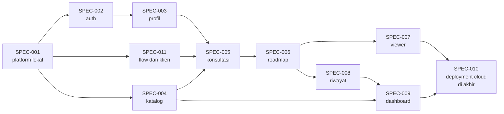

# Daftar Spec

Satu spec = satu fitur dengan acceptance criteria dan tugas. Spec adalah **unit kerja** untuk developer dan AI agent. Buat spec baru dengan `/new-spec <judul>` atau salin [`SPEC-000-template.md`](SPEC-000-template.md).

## Indeks

| Spec | Judul | Milestone | Pemilik | Prioritas | Status |
|---|---|---|---|---|---|
| [SPEC-001](SPEC-001-platform-skeleton-dan-cicd.md) | Kerangka platform lokal, CI, dan staging lokal | M0 sampai M1 | Anaya | Must | Siap |
| [SPEC-002](SPEC-002-auth-dan-rbac.md) | Autentikasi dan RBAC | M1 | Anaya, Bastian | Must | Siap |
| [SPEC-003](SPEC-003-profil-dan-transkrip.md) | Profil dan transkrip | M1 sampai M2 | Anaya, Bastian | Must | Siap |
| [SPEC-004](SPEC-004-katalog-dan-admin.md) | Katalog dan panel admin | M1 sampai M3 | Anaya, Bastian | Must | Siap |
| [SPEC-005](SPEC-005-konsultasi-ai.md) | Konsultasi AI (dialog manager, slot-filling, SSE) | M2 | Anaya, Bastian | Must | Siap |
| [SPEC-006](SPEC-006-generasi-roadmap-dan-guardrails.md) | Saran jalur, generasi roadmap, dan guardrails | M3 | Anaya | Must | Siap |
| [SPEC-007](SPEC-007-roadmap-viewer.md) | Roadmap viewer | M3 | Bastian | Must | Siap |
| [SPEC-008](SPEC-008-riwayat-feedback-progres.md) | Riwayat, umpan balik, progres | M3 sampai M4 | Anaya, Bastian | Must/Should | Siap |
| [SPEC-009](SPEC-009-dashboard-admin.md) | Dashboard admin | M4 | Anaya, Bastian | Should | Siap |
| [SPEC-010](SPEC-010-deployment-cloud-dan-kesiapan-demo.md) | Deployment cloud, keandalan, dan kesiapan demo | M5 (28 Nov sampai 3 Des) | Anaya | Must | Siap |
| [SPEC-011](SPEC-011-flow-langflow-dan-klien-fastapi.md) | Flow Langflow dan klien FastAPI | M1 sampai M3 | Anaya | Must | Siap |

## Urutan Pengerjaan yang Disarankan

Kolom **Status** diperbarui oleh pemilik saat pekerjaan berubah. Kontrak API tunggal: [`../api/openapi.yaml`](../api/openapi.yaml).
